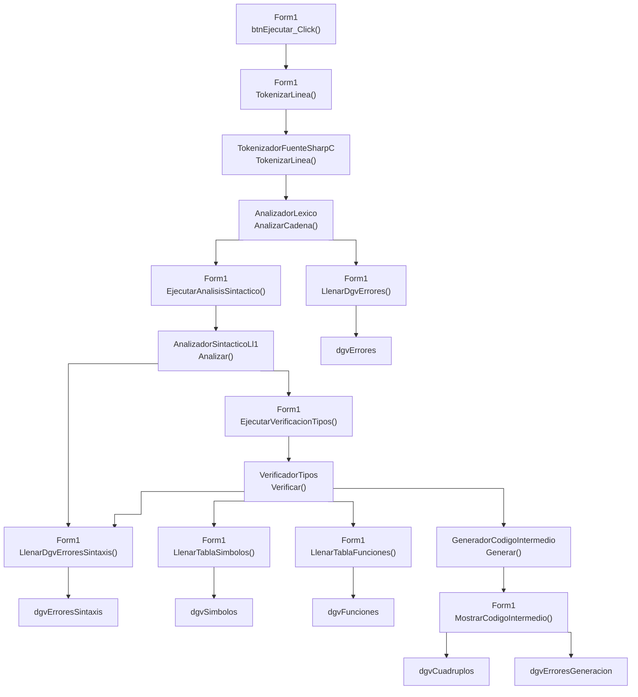
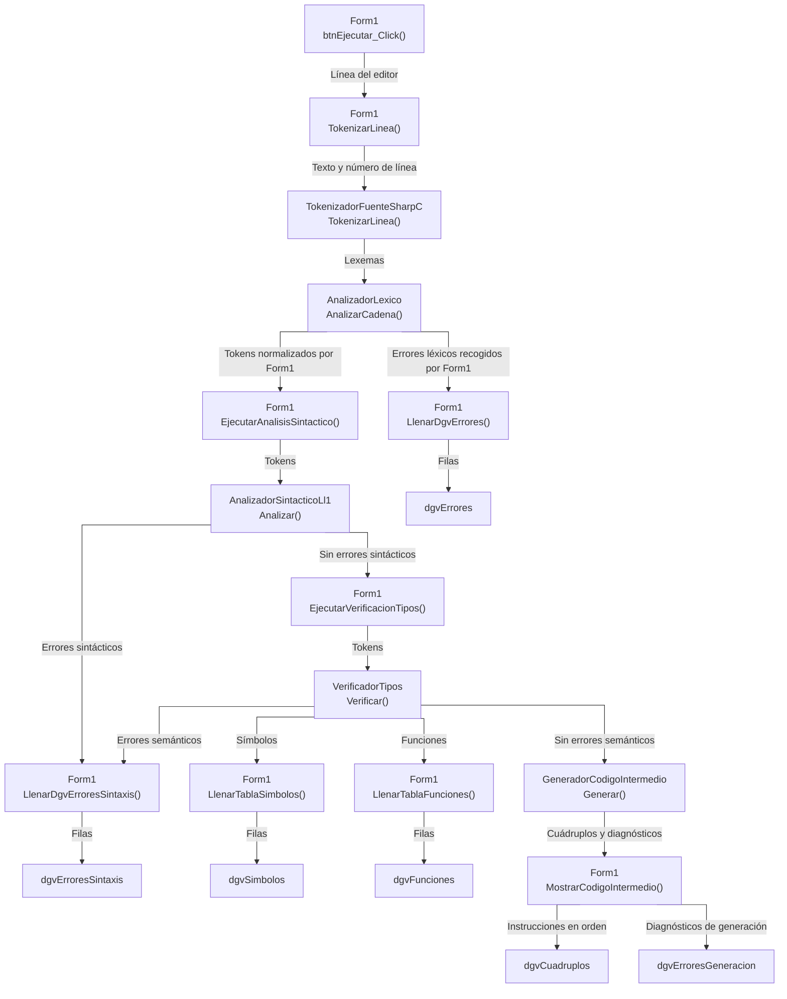

# Flujo de datos del programa

Recorrido simplificado desde el botón Ejecutar hasta los `DataGridView` de análisis y código intermedio. Las cajas indican la clase y el método; las últimas cajas son los controles del formulario. Las flechas muestran el avance de los datos, no una cadena de llamadas anidadas: `Form1` coordina las etapas y recoge sus resultados.

## 1. Sin texto en los nexos

## 2. Con texto en los nexos

## Notas de lectura

- El botón toma el código de `scintilla1`. La separación se repite por línea y la clasificación léxica por lexema; los comentarios se omiten del análisis sintáctico.
- `Form1` normaliza las categorías y construye `tokensSintactico`. El sintáctico se ejecuta solo si hay tokens y no hay errores léxicos; el semántico, solo si no hay errores sintácticos. Ambos reciben la lista de tokens.
- Al terminar, `Form1.btnEjecutar_Click()` llama siempre a los cuatro métodos de llenado, en este orden: errores léxicos, errores sintácticos/semánticos, símbolos y funciones. Si una etapa no se ejecutó, sus resultados quedan vacíos. Las ramas representan el destino de los resultados, no ejecución paralela.
- Los conectores usan `stepAfter`: tramos horizontales y verticales, sin curvas.
- Dentro de `MostrarCodigoIntermedio`, `ConstructorRepresentaciones.Construir` prepara Triplos, Código P y las tres notaciones a partir del IR común y los árboles fuente conservados. Se publican juntos en sus pestañas; no se vuelve a ejecutar el análisis al cambiar de vista. Los errores de conversión se muestran con línea y dejan vacías las salidas.
- La pestaña «Análisis» conserva los cuatro controles originales. «Código intermedio» contiene los cuádruplos y diagnósticos de generación para todos los tipos, control de flujo, funciones y operaciones incorporadas de la gramática. El generador solo publica salida si no encuentra errores. `Form1.LimpiarCodigoIntermedio()` invalida la salida al editar o iniciar otro análisis. El recorrido interno y las instrucciones están en el [contrato de código intermedio](plan-codigo-intermedio.md).

Fuente: [`Form1.cs`](../Automatas/Form1.cs), especialmente `btnEjecutar_Click()`, los métodos de análisis y los métodos de llenado.
