# Guía visual para defender el código intermedio ante el profesor

**Situación:** el profesor abre una clase o un método y pregunta: «¿Esto para qué sirve?». Esta guía te permite ubicarlo en el recorrido y explicar su entrada, transformación y salida.

Es la versión gráfica de la [segunda perspectiva de la guía completa](flujo-codigo-intermedio-tres-perspectivas.md#2-para-responder-al-profesor). Los nombres corresponden a la implementación actual.

## Cómo usarla

```text
EL PROFESOR ABRE UN MÉTODO
            │
            ▼
  1. Ubica la clase en el mapa
            │
            ▼
  2. Identifica qué recibe
            │
            ▼
  3. Explica qué transforma
            │
            ▼
  4. Señala qué devuelve o modifica
```

> **Fórmula para responder:** «Este método recibe **X**, hace **Y** y entrega **Z**. Lo llama **A** y su resultado lo usa **B**».

Los diagramas Mermaid usan conectores con tramos rectos. Se pueden abrir en un visor Markdown compatible con Mermaid o copiar a [Mermaid Live](https://mermaid.live/) para exportarlos como imagen. Los bloques de texto también permiten seguir la explicación sin renderizador.

### Navegación rápida

| Si abre… | Ve a… |
| --- | --- |
| `Form1` | [El coordinador](#2-form1-el-coordinador) |
| `Generar` o `Sesion` | [El generador y su mesa de trabajo](#3-generar-y-sesion) |
| `Bloque` o `Asignar` | [El distribuidor de instrucciones](#4-bloque-y-asignar) |
| `Parsear`, `ExpresionRango`, `Registrar` | [Construir y conservar expresiones](#5-construir-y-conservar-la-expresión) |
| `Emitir`, `Capturar`, `Agregar` | [Crear las instrucciones](#6-emitir-capturar-y-agregar) |
| `Funcion`, ciclos o etiquetas | [Flujo de control y funciones](#7-etiquetas-selección-ciclos-y-funciones) |
| `Cuadruplo` y otras clases de datos | [Mapa de objetos](#8-mapa-visual-de-los-objetos) |
| `GeneradorTriplos` | [Triplos](#10-generadortriplos) |
| `GeneradorCodigoP` | [Código P](#11-generadorcodigop) |
| `FormateadorNotaciones` | [Tres notaciones](#12-formateadornotaciones) |
| Errores o controles de salida | [Errores](#14-dónde-se-detiene-el-proceso-si-hay-errores) y [pantalla](#13-cómo-llega-todo-a-la-pantalla) |

---

## 1. El mapa que debes recordar

**Este es un mapa de datos.** Las ramas no indican que el programa ejecute tareas en paralelo.

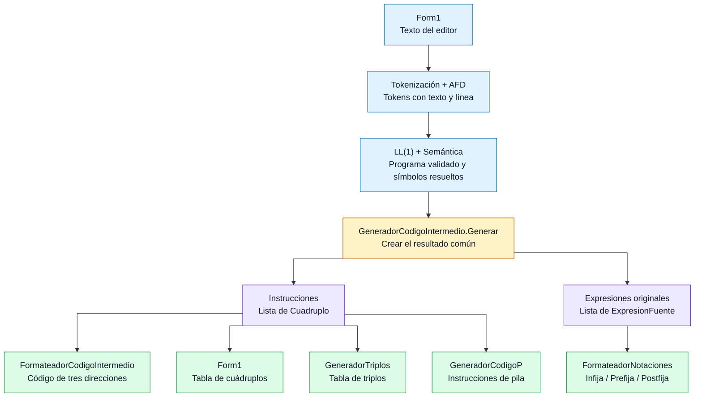

### Respuesta de 15 segundos

> «Primero validamos el programa. Después construimos cuádruplos y conservamos las expresiones originales. De los cuádruplos salen las representaciones de instrucciones; de los árboles salen las tres notaciones. El formulario muestra los resultados».

**Distinción clave:** código de tres direcciones y cuádruplos presentan directamente la misma lista. Triplos y Código P son traducciones equivalentes de esa lista. Notaciones muestra expresiones fuente completas.

---

## 2. Form1: el coordinador

Archivo: [`Form1.cs`](../Automatas/Form1.cs).

### «¿Qué hace btnEjecutar_Click?»

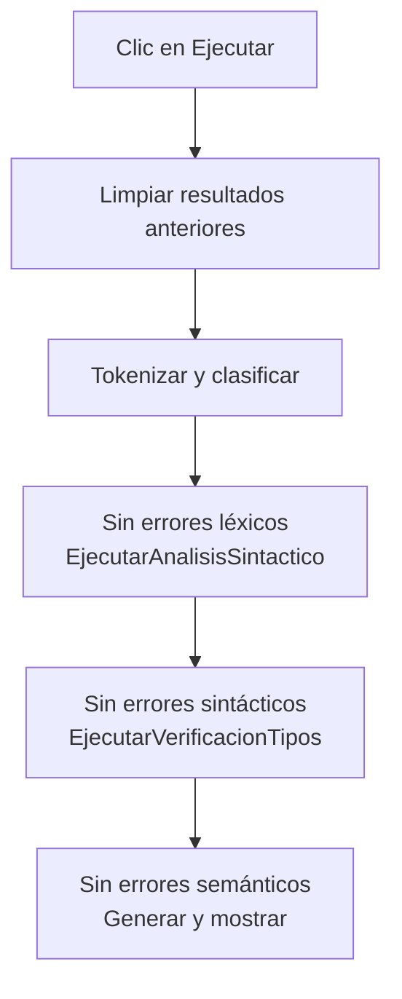

> **Qué responder:** «Controla el orden de las etapas. No permite continuar con la siguiente si la anterior tiene errores».

### «¿Qué hace EjecutarVerificacionTipos?»

```text
tokensSintactico
       │
       ▼
new VerificadorTipos(null)
       │
       ▼
verificador.Verificar(tokensSintactico)
       │
       ├── Símbolos y funciones → tablas del análisis
       ├── Errores → erroresTipos
       │
       └── Si no hay errores:
               Generar(verificador)
                       │
                       ▼
               MostrarCodigoIntermedio(resultado)
```

> **Qué responder:** «Construye la semántica y entrega ese mismo verificador al generador, para reutilizar tokens, tipos y declaraciones resueltas».

### «¿Y el botón de la segunda pestaña?»

```text
btnGenerarCuadruplos_Click
            │
            ▼
    btnEjecutar_Click
            │
            ▼
Seleccionar Código intermedio
```

Usa el mismo recorrido. El nombre del botón manejador es histórico: ahora prepara las cinco vistas.

### «¿Por qué limpiar?»

```text
ANTES: fuente A → resultados de A
                   │
Usuario edita      ▼
DESPUÉS: fuente B → vistas vacías hasta analizar B
```

`LimpiarCodigoIntermedio` limpia cuádruplos, tres direcciones, triplos, P, notaciones y diagnósticos de generación. Su parámetro `estado` no se utiliza actualmente para mostrar un mensaje.

---

## 3. Generar y Sesion

Archivo: [`GeneradorCodigoIntermedio.cs`](../Automatas/GeneradorCodigoIntermedio.cs).

### Ficha: Generar

| Entrada | Trabajo | Salida |
| --- | --- | --- |
| `VerificadorTipos analisis` | Comprobar precondiciones y LL(1); crear sesión; recorrer el principal. | `ResultadoCodigoIntermedio` |

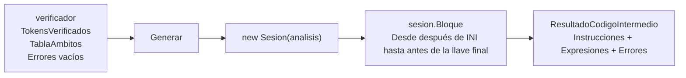

> **Qué responder:** «Generar es la entrada al traductor. No recibe texto del editor: recibe el análisis válido y devuelve las estructuras del código intermedio».

### Ficha: Sesion

Piensa en la sesión como la **mesa de trabajo de una sola traducción**:

```text
┌──────────────────── Sesion ─────────────────────┐
│ analisis       → símbolos y reglas de tipos     │
│ tokens         → programa original clasificado  │
│ cierres        → apertura ↔ cierre              │
│ temporal       → 0, 1, 2... para t1, t2...       │
│ etiqueta       → 0, 1, 2... para L1, L2...       │
│ funcionActual  → null en INI, símbolo en función │
│ Instrucciones  → cuádruplos que se van creando   │
│ Expresiones    → árboles fuente conservados     │
└────────────────────────────────────────────────┘
```

> **Qué responder:** «Separa el estado de una generación. Cada programa empieza con sus propias listas y contadores».

### «¿Para qué es cierres?»

```text
SI ( vR > 10 ) { IMP(vR); }
   └─────────┘ └──────────┘
    una pareja   otra pareja
```

El arreglo guarda posiciones: `cierres[posicionApertura] = posicionCierre`. Así se sabe dónde termina una condición o un cuerpo sin buscar por líneas.

---

## 4. Bloque y Asignar

### Ficha: Bloque

**Es el distribuidor de instrucciones.**

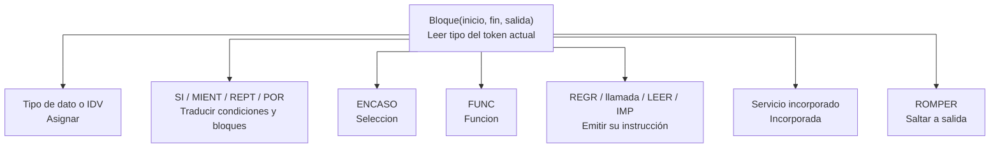

> **Qué responder:** «Bloque recorre un rango de tokens e identifica qué traducción debe realizar. Los cuerpos anidados vuelven a llamar a Bloque».

`inicio` está incluido; `fin` está excluido. `salida` es la etiqueta del contenedor del que puede salir un `ROMPER`.

### Ficha: Asignar

Ejemplo: `ENT vR = vA + 3 * 4;`.

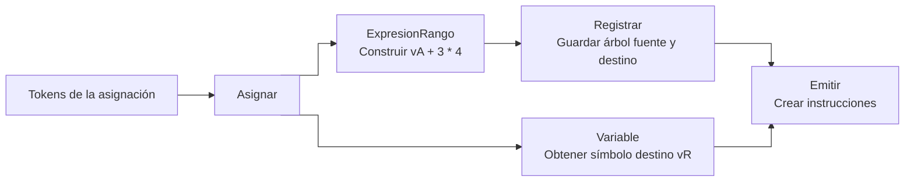

| Caso | Resultado |
| --- | --- |
| `ENT vR;` | La variable ya está declarada por semántica; no genera asignación. |
| `vR = 2;` | Un cuádruplo de copia. |
| `vR = vA + 3 * 4;` | Instrucciones para la expresión. |
| `vR = LEER();` | Lectura al destino y registro de la forma fuente. |

> **Qué responder:** «Obtiene el destino y traduce el lado derecho. No inicializa a cero las declaraciones sin valor».

---

## 5. Construir y conservar la expresión

### Dos acciones que no deben confundirse

```text
CONSTRUIR                               CONSERVAR

Tokens                                  Árbol construido
  │                                           │
  ▼                                           ▼
ExpresionRango                           Registrar
  │                                           │
  ▼                                           ▼
Parsear                                 ExpresionFuente
  │                                     + contexto
  ▼                                     + destino
ExpresionIntermedia                     + posición / función
```

`Fuente` es un atajo para construir y registrar. `RegistrarLlamada` crea y registra formas de llamadas incorporadas, como `IMP(expresión)`.

### Ficha: ExpresionRango

```text
Entrada: posiciones que delimitan vA + 3 * 4
                 │
                 ▼
       Parsear(ref i, fin, 0)
                 │
                 ▼
     Comprobar que i llegó a fin
                 │
                 ▼
Salida: árbol completo de ese fragmento
```

> **Qué responder:** «Delimita una expresión y se asegura de que el parser no deje tokens sin consumir».

### Ficha: Parsear

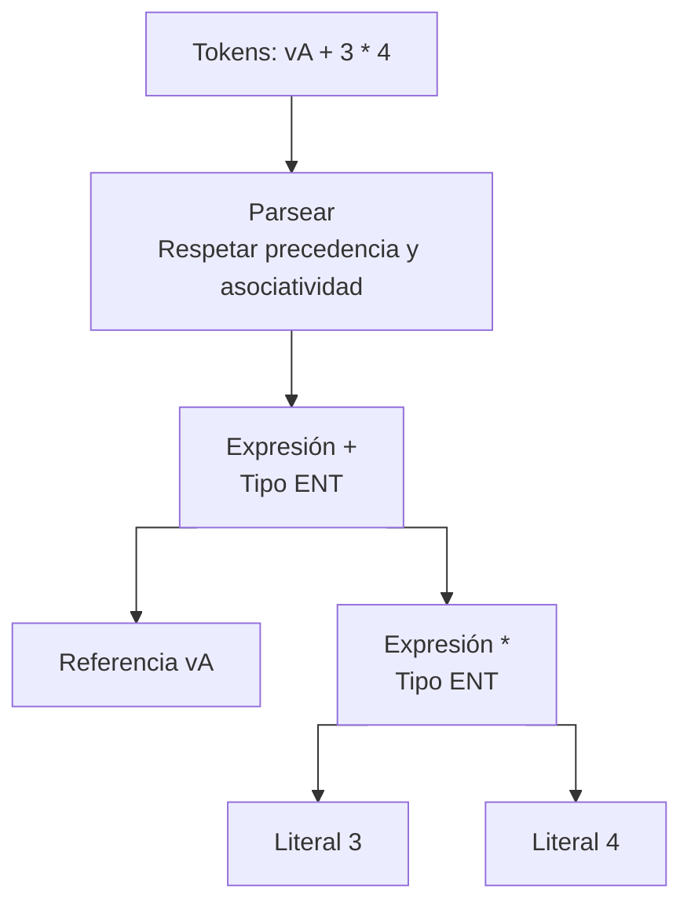

> **Qué responder:** «Construye la agrupación de la expresión, no su valor. Consulta OperadoresExpresion y las reglas de tipos del verificador».

| Elemento del método | Qué significa |
| --- | --- |
| `ref i` | La llamada actualiza hasta dónde consumió tokens. |
| `minimo` | Precedencia mínima que se permite incorporar en esa llamada. |
| Recursión para el derecho | Construye el subárbol respetando asociatividad; potencia permite agrupar a la derecha. |
| `EvaluarOperacion` | Obtiene el tipo resultante y comprueba compatibilidad. |

### Ficha: Registrar

```text
Expresión +(vA, *(3,4))
            │
            ▼
┌────────── ExpresionFuente ──────────┐
│ Árbol: expresión completa           │
│ Destino: vR                         │
│ Contexto: Asignación                │
│ Línea y posición de token           │
│ Función contenedora o principal     │
└────────────────────────────────────┘
```

> **Qué responder:** «Conserva el original para que Notaciones muestre vA + 3 * 4 y no una fórmula incompleta con t1».

---

## 6. Emitir, Capturar y Agregar

### Ficha: Emitir

**Entrada:** árbol. **Efecto:** agrega cuádruplos. **Devuelve:** operando donde estará el resultado.

```text
                +(vA, *(3,4))
                       │
                       ▼
               Emitir la suma
                │           │
                ▼           ▼
           Emitir vA     Emitir producto
                │       │           │
                ▼       ▼           ▼
            devolver   literal 3   literal 4
               vA           │       │
                            └───┬───┘
                                ▼
                       Agregar t1 = 3 * 4
                                │
                                ▼
                            devolver t1
                │               │
                └───────┬───────┘
                        ▼
                Agregar vR = vA + t1
                        │
                        ▼
                    devolver vR
```

> **Qué responder:** «Obtiene primero los operandos y luego emite la operación. Un dato simple se devuelve directamente; el destino final permite evitar un temporal innecesario».

Los nodos no son cuádruplos. `Emitir` hace la transición entre ambas estructuras.

### Ficha: Agregar

```text
Operación + destino + fuentes + tipo + posición
                       │
                       ▼
                 new Cuadruplo(...)
                       │
                       ▼
               Instrucciones.Add(...)
```

> **Qué responder:** «Es el punto común donde se guardan las instrucciones, con línea fuente y función actual. No decide la precedencia».

### Ficha: Capturar

Problema concreto:

```text
vA + fCambiar()
```

La función podría cambiar `vA`. Hay que preservar el valor que se leyó antes de llamar:

```text
LEER vA ANTES DE LA LLAMADA        REPRESENTAR LA LLAMADA
             │                              │
             ▼                              ▼
         t1 = vA                   t2 = call fCambiar, 0
             │                              │
             └──────────────┬───────────────┘
                            ▼
                      resultado = t1 + t2
```

Aquí «leer vA» significa consultar su valor durante una futura ejecución; no es la instrucción de entrada `LEER()`.

> **Qué responder:** «Captura variables en temporales para conservar el orden de evaluación. También protege argumentos ya evaluados frente a llamadas anidadas».

---

## 7. Etiquetas, selección, ciclos y funciones

### t, r y L: tres nombres que hacen cosas distintas

| Nombre | Representa | Lo crea |
| --- | --- | --- |
| `t1` | Resultado temporal del IR común. | `Sesion.Temporal` |
| `r1` | Acumulador de la conversión a triplos. | `GeneradorTriplos.Generar` |
| `L1` | Punto de continuación del flujo. | `Sesion.Etiqueta` |

### «¿ETIQUETA y L1 son lo mismo?»

```text
CUÁDRUPLO                         TEXTO

Destino: L1
Operación: ETIQUETA  ───────────►  L1:

Destino: L1
Operación: SALTO     ───────────►  goto L1
```

`ETIQUETA` es la operación que marca el lugar; `L1` es su nombre. `Marcar` agrega la primera y `Saltar` agrega la segunda.

### «¿Cómo se baja SI/SINO?»

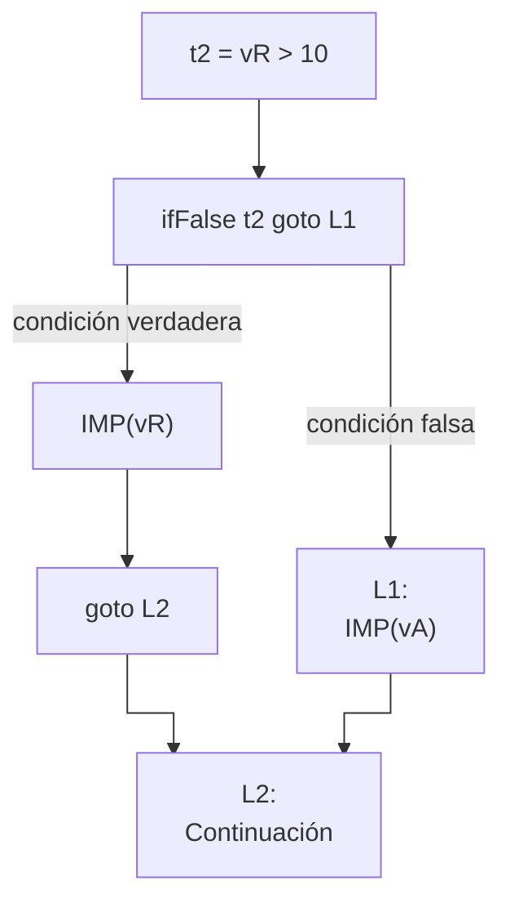

> **Qué responder:** «La condición se vuelve una operación booleana y las ramas se conectan con etiquetas y saltos. SI/SINO está implementado dentro de Bloque».

### «¿Cómo se baja un ciclo MIENT?»

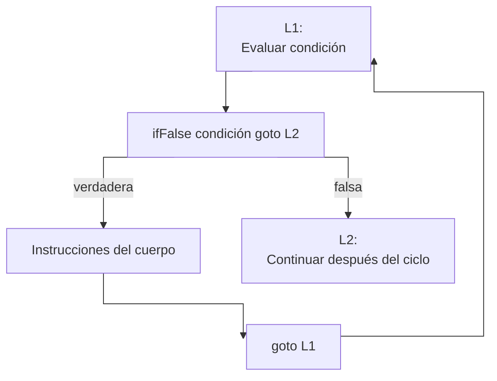

La condición está después de la etiqueta de inicio, por lo que se vuelve a evaluar en cada iteración. En REPT se evalúa al final; POR añade inicialización antes del ciclo e incremento después del cuerpo.

### Ficha: Seleccion

```text
ENCASO(selector)
       │
       ▼
Capturar selector una vez
       │
       ▼
Comparar caso → saltar al siguiente si no coincide
       │
       ▼
Traducir cuerpo → saltar al final
       │
       ▼
DFCT cuando no hubo coincidencia
```

> **Qué responder:** «Seleccion traduce ENCASO, no SI. Evita caída entre ramas y respeta la salida de ROMPER».

### Ficha: Funcion

```text
FLUJO NORMAL DEL PRINCIPAL        CUERPO EMITIDO

goto L1 ─────────────────┐       func fDoble -> ENT
                         │           param 0: ENT vX
                         │           t1 = vX * 2
                         │           return t1
                         │       endfunc fDoble
                         ▼
                        L1:
                  sigue el principal
```

> **Qué responder:** «Se traduce el cuerpo una sola vez y se protege con un salto para no ejecutarlo al declarar. Funcion cambia el contexto actual, traduce el cuerpo y restaura el contexto exterior».

Una llamada se representa aparte:

```text
Expresión fDoble(vA)
         │
         ▼
Argumentos → árboles de argumentos
         │
         ▼
Emitir + Capturar → t2 = vA
         │
         ▼
ARGUMENTO → arg 0, t2
         │
         ▼
LLAMAR → t3 = call fDoble, 1
```

El `1` es la cantidad de argumentos, no el valor del argumento. La llamada conserva el símbolo de la función; no vuelve a generar su cuerpo.

### Ficha: Incorporada

```text
Token de ACT 3                  Traducción

PR6  → LIMP                     Servicio sin argumentos
PR7  → FONCOL                   Servicio con color de fondo
PR8  → TXTCOL                   Servicio con color de texto
PR9  → SLTLN                    Servicio con cantidad
PR10 → POS                      Servicio con coordenadas
PR29 → INTER                    Tres copias con temporal
PR30 → TECL                     Servicio sin argumentos
PR31 → IMPREP                   Servicio con texto y cantidad
```

> **Qué responder:** «Traduce las incorporadas oficiales. INTER intercambia valores; no declara ni manipula arreglos».

---

## 8. Mapa visual de los objetos

Archivos: [`Cuadruplo.cs`](../Automatas/Cuadruplo.cs), [`ExpresionIntermedia.cs`](../Automatas/ExpresionIntermedia.cs), [`RepresentacionesIntermedias.cs`](../Automatas/RepresentacionesIntermedias.cs).

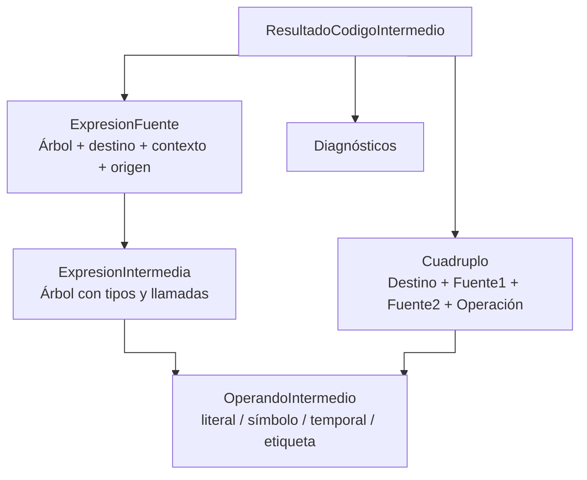

### Fichas de una línea

| Objeto | Frase para defenderlo |
| --- | --- |
| `OperandoIntermedio` | «Representa un dato usado en las instrucciones, conservando su identidad y tipo». |
| `ExpresionIntermedia` | «Representa cómo está organizada una expresión antes de dividirla en instrucciones». |
| `ExpresionFuente` | «Conecta el árbol con su asignación, condición, línea y función». |
| `Cuadruplo` | «Guarda una instrucción del IR común y sus metadatos». |
| `ResultadoCodigoIntermedio` | «Devuelve instrucciones, expresiones originales y errores». |
| `Triplo` | «Guarda un registro de acumulador con objeto, fuente y operador». |
| `InstruccionP` | «Guarda una instrucción de pila, su tipo, efecto de altura y origen». |
| `NotacionExpresion` | «Agrupa las cadenas infija, prefija y postfija de una expresión fuente». |
| `ResultadoRepresentaciones` | «Agrupa las nuevas conversiones y sus errores». |

No confundas un objeto que **guarda datos** con un método que **produce o transforma esos datos**.

---

## 9. ConstructorRepresentaciones: la bifurcación de salidas

Archivo: [`RepresentacionesIntermedias.cs`](../Automatas/RepresentacionesIntermedias.cs).

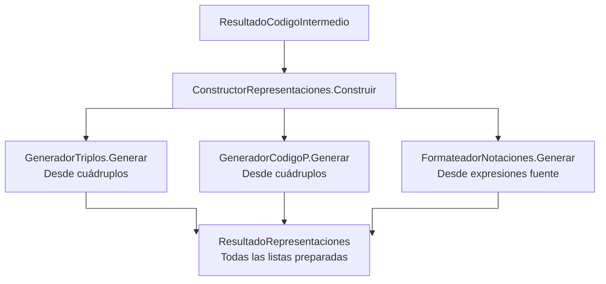

> **Qué responder:** «Coordina las conversiones sin repetir el análisis del lenguaje. Solo entrega resultados cuando las tres conversiones terminaron correctamente».

Las ramas muestran dependencia de datos. En el código, las llamadas son secuenciales.

```text
Si una conversión falla:

ErrorRepresentacion
        │
        ▼
Resultado con diagnóstico y listas vacías
        │
        ▼
No publicar una mezcla de vistas completas e incompletas
```

---

## 10. GeneradorTriplos

Archivo: [`GeneradorTriplos.cs`](../Automatas/GeneradorTriplos.cs).

### Transformación visible

```text
UN CUÁDRUPLO                   TRES REGISTROS DE ACUMULADOR

t1 = 3 * 4                     r1 ← 3
                    ────────►  r1 ← r1 * 4
                               t1 ← r1
```

| Objeto | Fuente | Operador | Lectura |
| --- | --- | --- | --- |
| r1 | 3 | — | Carga inicial. |
| r1 | 4 | * | Combinar acumulador y fuente. |
| t1 | r1 | = | Copiar al destino original. |

> **Qué responder:** «Usa los triplos de acumulador del material de clase. La traducción es equivalente, aunque use más registros que una versión compacta».

### «¿Por qué no calcular directamente en el destino?»

```text
FUENTE: vA = 3 - vA

INCORRECTO                      ACTUAL
vA = 3                          r1 = 3
vA = vA - vA                    r1 = r1 - vA
                                vA = r1

Se perdió el valor anterior.     El valor anterior se conserva.
```

El tipo efectivo del acumulador está en `Triplo.TipoResultado` por registro: una comparación puede cargar ENT y después producir BOOL. `ACUMULADOR` no es un tipo declarable de SharpC.

### «¿Cómo cabe una llamada en tres campos?»

```text
CUÁDRUPLO: resultado, función, aridad, LLAMAR
                         │
                         ▼
TRIPLO 1: función, aridad, PREPARAR_LLAMADA
TRIPLO 2: resultado, función, LLAMAR
```

No se elimina la cantidad de argumentos para hacer que quepa en la tabla.

---

## 11. GeneradorCodigoP

Archivo: [`GeneradorCodigoP.cs`](../Automatas/GeneradorCodigoP.cs).

### Del cuádruplo a instrucciones de pila

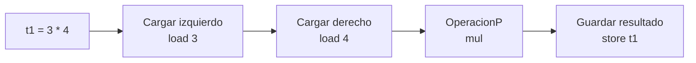

> **Qué responder:** «Traduce a una máquina de pila conservando tipos y orden. No ejecuta esa máquina: genera y valida sus instrucciones».

### La altura prevista de la pila

| Instrucción emitida | Pila que tendría una ejecución | Altura prevista |
| --- | --- | ---: |
| Inicio | `[]` | 0 |
| `load 3` | `[3]` | 1 |
| `load 4` | `[3, 4]` | 2 |
| `mul` | `[resultado]` | 1 |
| `store t1` | `[]` | 0 |

En generación solo se actualiza el contador de altura. No se almacena ni calcula el resultado numérico de esa tabla ilustrativa.

### Auxiliares locales

```text
Cargar(operando) ──► Emitir(load)  ──► altura + 1

OperacionP(*)   ──► nombre mul

Guardar()       ──► Emitir(store) ──► altura - 1
```

`Emitir` aquí es una función local de `GeneradorCodigoP.Generar`. No es `Sesion.Emitir`, que recorre árboles.

### «¿Por qué comprobar altura cero?»

```text
Cuádruplo A → instrucciones P → pila vacía
Cuádruplo B → instrucciones P → pila vacía
Etiqueta    → entrada sin residuos anteriores
```

> **Qué responder:** «Así las ramas y las funciones no dependen de valores que quedaron olvidados de otra instrucción».

En resta y división se carga primero el izquierdo y después el derecho. La operación toma el derecho de la cima, pero realiza `izquierdo - derecho` o `izquierdo / derecho`.

`arg` extrae un valor a un grupo de argumentos pendiente de esa activación; ese grupo es distinto de la pila de evaluación. Esto ayuda a conservar las llamadas anidadas y recursivas.

---

## 12. FormateadorNotaciones

Archivo: [`FormateadorNotaciones.cs`](../Automatas/FormateadorNotaciones.cs).

### Un árbol, tres recorridos

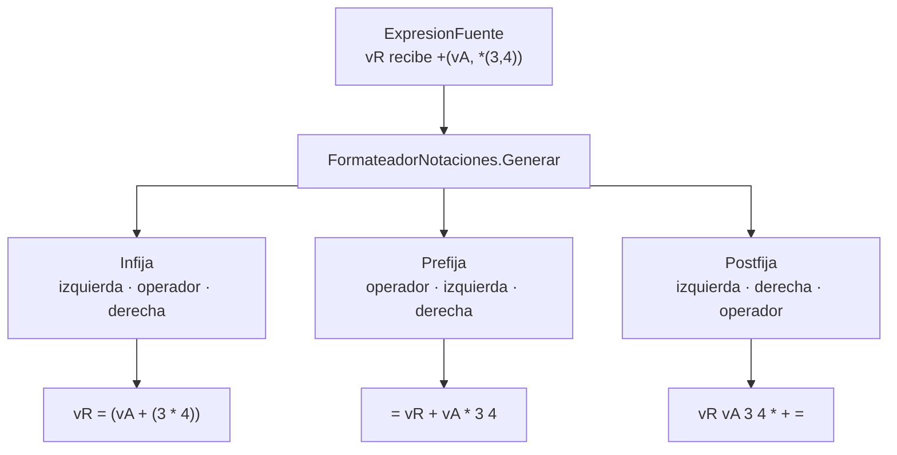

> **Qué responder:** «Presenta la expresión original en tres órdenes. La infija se parentiza para dejar explícita la agrupación; prefija usa preorden y postfija postorden».

### «¿Por qué no usar los temporales?»

```text
ÁRBOL FUENTE                      CUÁDRUPLOS
vA + 3 * 4                        t1 = 3 * 4
                                  vR = vA + t1
     │                                  │
     ▼                                  ▼
Notación de la cuenta completa.    Instrucciones para realizarla.
```

Cada forma responde una pregunta diferente. Por eso el generador conserva ambas.

### «¿Cómo se representa una llamada?»

```text
Infija:   fSuma(1, fUno())
Prefija:  call[fSuma/2] 1 call[fUno/0]
Postfija: 1 call[fUno/0] call[fSuma/2]
```

`/2` y `/0` indican aridad: cantidad de argumentos. No significan división.

---

## 13. Cómo llega todo a la pantalla

### Ficha: MostrarCodigoIntermedio

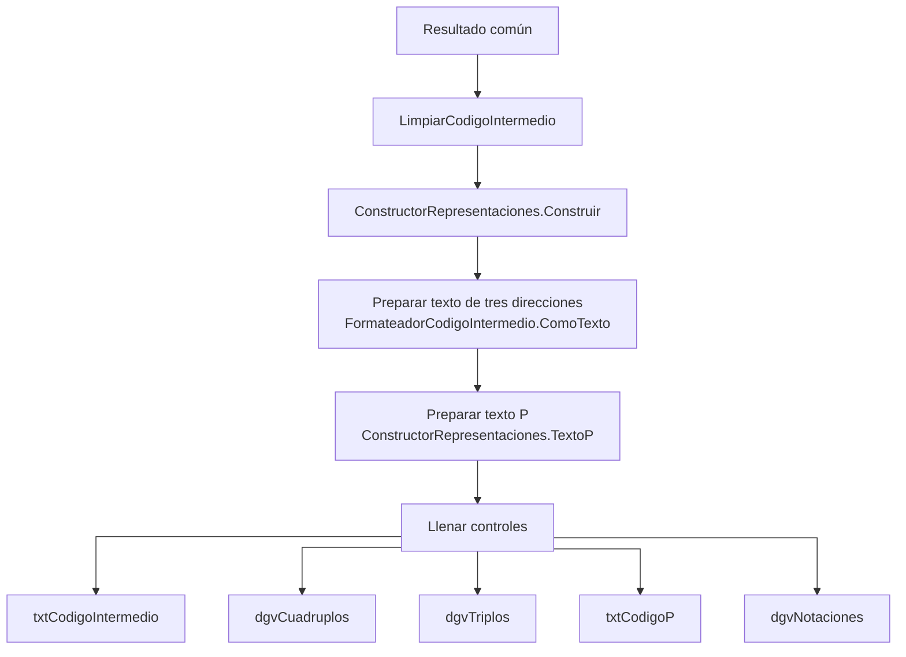

El diagrama muestra el camino de éxito. Si `Construir` devuelve errores, se muestran diagnósticos y el método regresa antes de preparar textos o llenar las cinco vistas.

### «¿Qué hace el formateador de tres direcciones?»

Archivo: [`FormateadorCodigoIntermedio.cs`](../Automatas/FormateadorCodigoIntermedio.cs).

```text
Cuádruplo                        Instruccion(q)
┌──────────────────┐             │
│ Destino: t1      │             ▼
│ Fuente1: 3       │    "t1 = 3 * 4"
│ Fuente2: 4       │             │
│ Operación: *     │             ▼
└──────────────────┘         ComoTexto()
                                │
                                ▼
                     Texto completo de la lista
```

`Operando()` comparte los nombres visibles entre vistas. Si dos símbolos diferentes se llaman `vDato`, puede mostrarlos como `vDato#1` y `vDato#2`, usando sus IDs reales.

> **Qué responder:** «Los controles no generan instrucciones. Reciben listas y textos preparados. Cambiar de pestaña no vuelve a ejecutar el analizador».

---

## 14. Dónde se detiene el proceso si hay errores

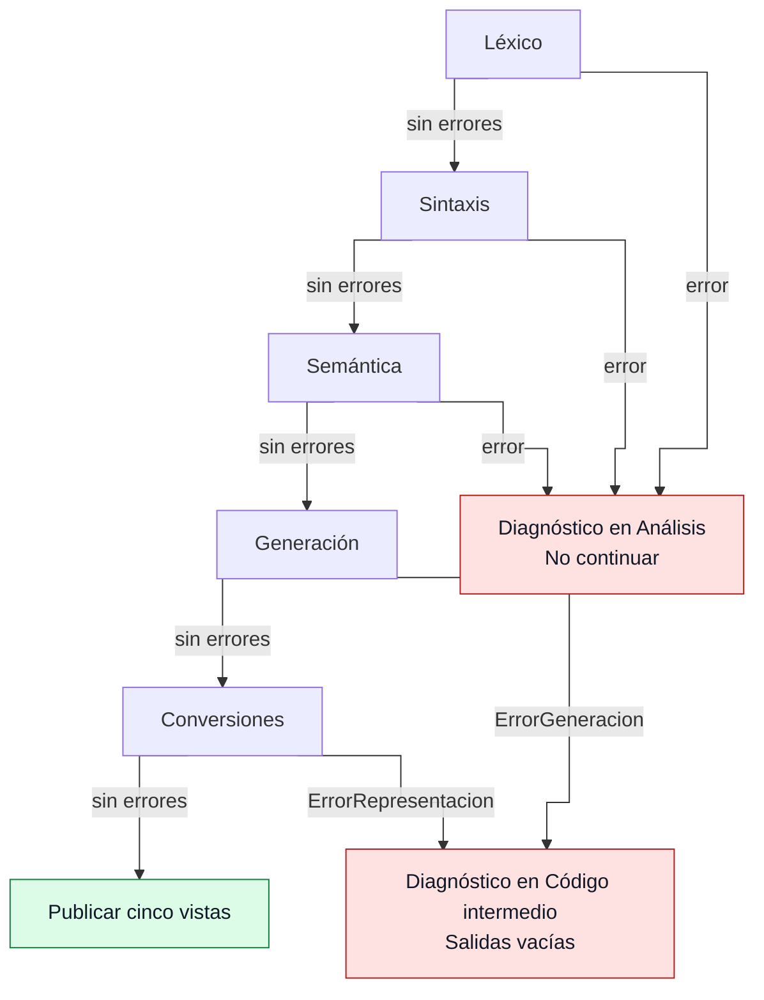

### Respuestas para tres ejemplos

| Ejemplo | Dónde se detecta | Qué responder |
| --- | --- | --- |
| Variable usada sin inicializar. | Semántica: `AnalizadorInicializacion`. | «No debe llegar a generación». |
| Función no VAC con un camino sin retorno. | Semántica: `AnalizadorRetornos`. | «Se rechaza antes de crear código; no emitimos un trap de falta de retorno». |
| ROMPER sin ciclo/caso válido. | Generación: comprobación actual en `Bloque`. | «El generador descarta su salida y muestra el diagnóstico». |

No todas las comprobaciones defensivas pertenecen actualmente a la misma etapa. Los errores de significado nuevos deben ubicarse en semántica cuando corresponda. Las excepciones esperadas de generación/conversión se capturan específicamente; no se convierte automáticamente cualquier defecto de programación en un error de tipos.

---

## 15. Tarjeta final: defender el sistema en un minuto

```text
¿QUIÉN COORDINA?         Form1

¿QUIÉN REVISA?           Léxico → LL(1) → Semántica

¿QUIÉN ORGANIZA CUENTAS? Parsear → ExpresionIntermedia

¿QUIÉN CONSERVA FUENTE?  Registrar → ExpresionFuente

¿QUIÉN TRADUCE?          Emitir / Agregar → Cuadruplo

¿QUIÉN CONVIERTE?        GeneradorTriplos / GeneradorCodigoP

¿QUIÉN CAMBIA NOTACIÓN?  FormateadorNotaciones

¿QUIÉN PRESENTA TEXTO?   FormateadorCodigoIntermedio / TextoP

¿QUIÉN MUESTRA?          MostrarCodigoIntermedio → controles
```

### Cinco frases que evitan confusiones

1. **«Construir un árbol no es calcular su resultado».**
2. **«Generar instrucciones no es ejecutarlas».**
3. **«Notación y representación intermedia no son la misma clasificación».**
4. **«Los símbolos conservan identidad; el nombre por sí solo no basta».**
5. **«Las vistas comparten una traducción y no publican resultados parciales si una conversión falla».**

Para ampliar una respuesta: [guía de las tres perspectivas](flujo-codigo-intermedio-tres-perspectivas.md), [contrato de instrucciones](plan-codigo-intermedio.md) y [pruebas](pruebas-analizadores.md).
