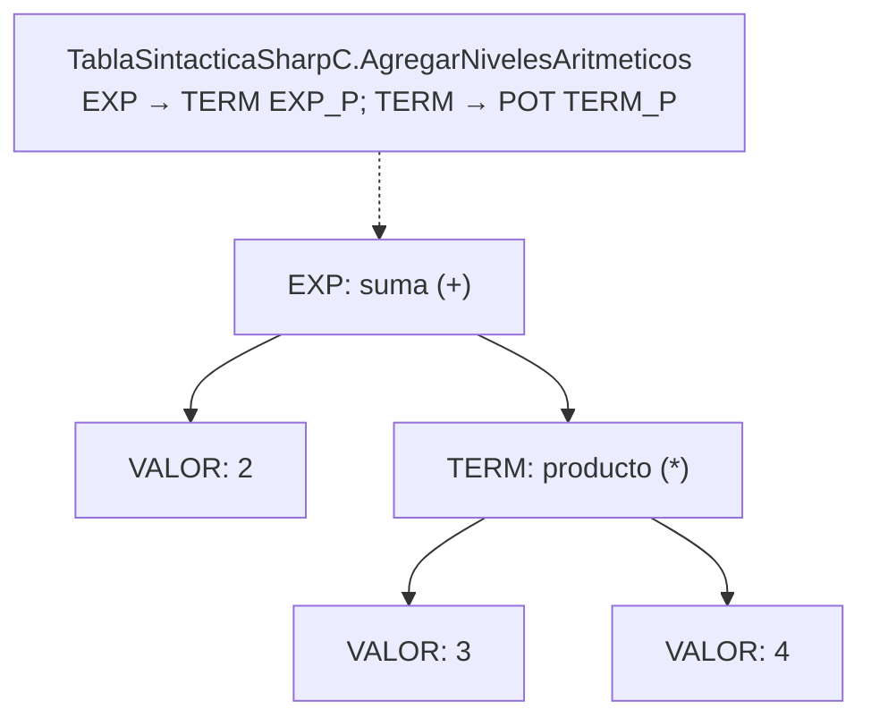
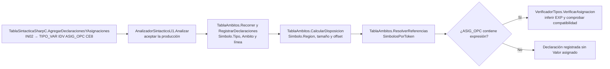
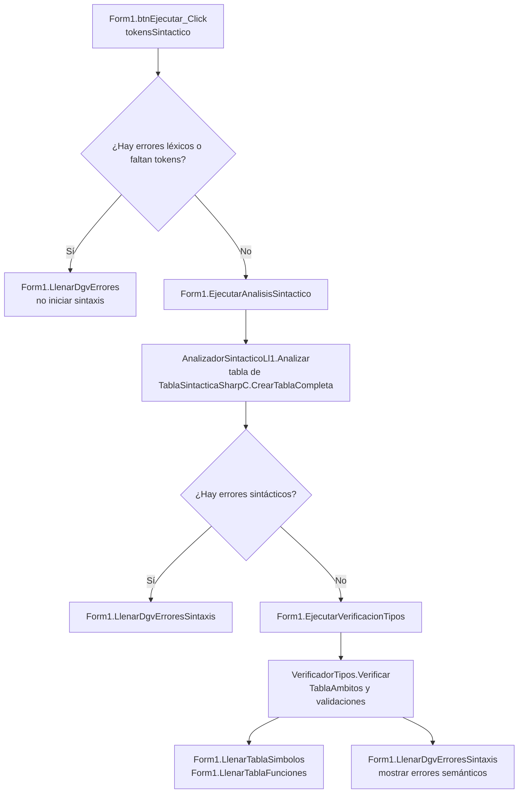
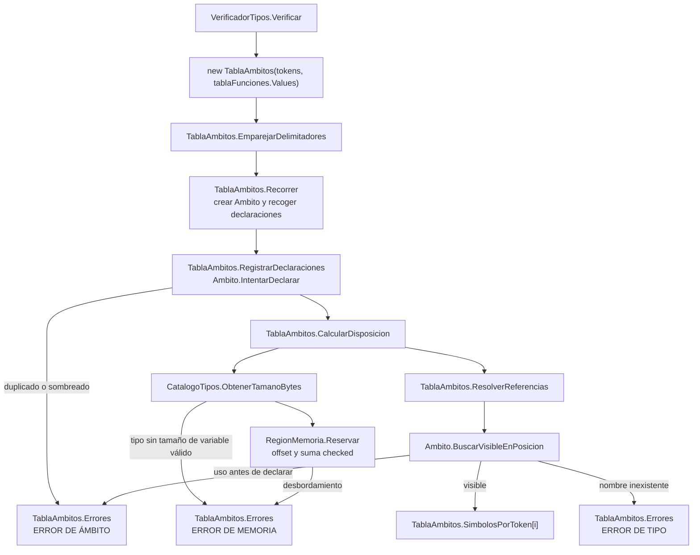
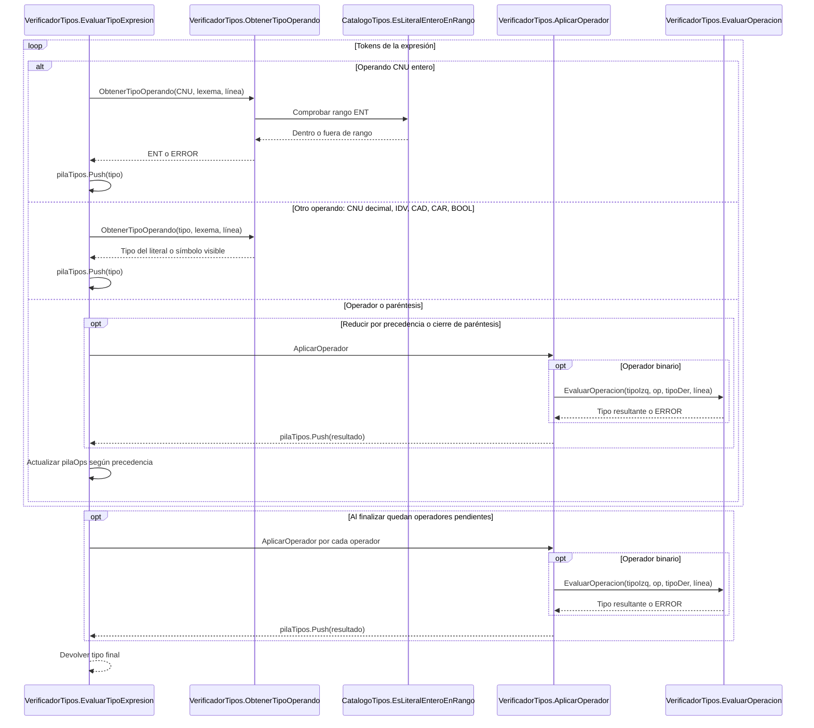
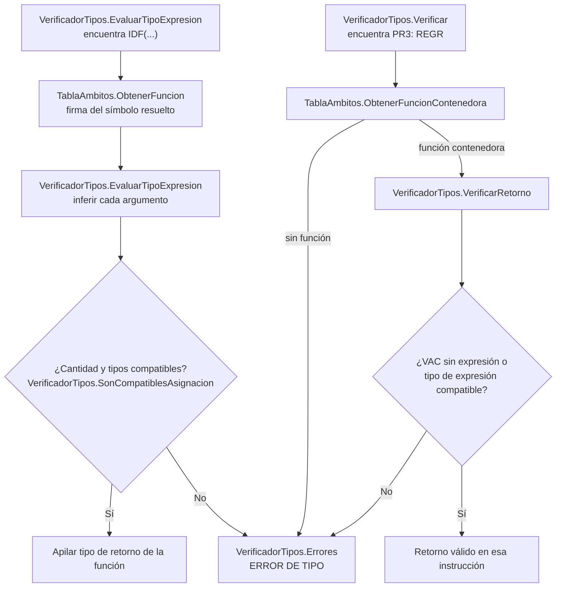
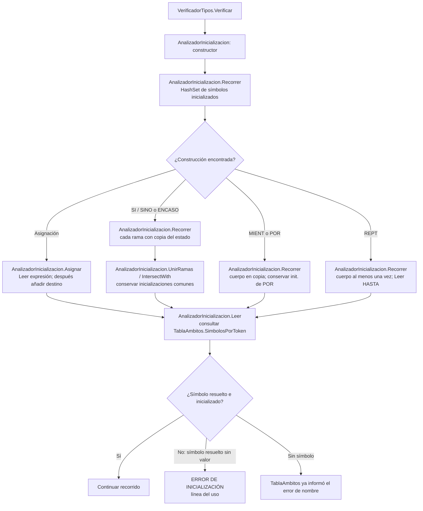
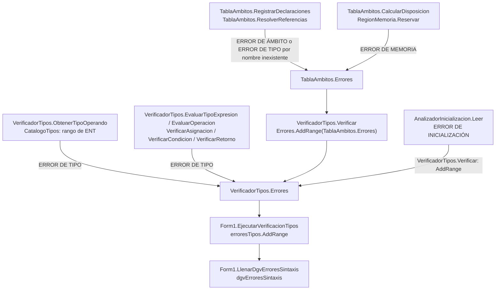

# Presentación técnica del analizador de SharpC

## Índice

1. [Introducción](#introducción)
2. [Antecedentes](#antecedentes)
3. [Aplicaciones](#aplicaciones)
4. [Código](#código)
5. [Resultados](#resultados)
6. [Conclusiones](#conclusiones)
7. [Bibliografía](#bibliografía)
8. [Glosario](#glosario)

## Introducción

El proyecto **AnalizadorLexico2** analiza programas escritos en un lenguaje educativo cuya gramática se implementa en `TablaSintacticaSharpC.cs`. Su propósito es identificar los componentes del código fuente, comprobar su estructura y detectar usos que contradicen las reglas semánticas del lenguaje. Ofrece diagnósticos con número de línea y presenta declaraciones, funciones y errores en una aplicación Windows Forms.

El procesamiento se organiza en tres etapas. El **análisis léxico** separa el texto en lexemas y los clasifica como palabras reservadas, identificadores, números, operadores y otros tokens. El **análisis sintáctico** utiliza una tabla predictiva LL(1) para comprobar si los tokens siguen las producciones de la gramática. Cuando la sintaxis es válida, el **análisis semántico** construye ámbitos, resuelve identificadores, infiere tipos, asigna desplazamientos simbólicos y verifica inicialización, llamadas y retornos.

Una expresión puede ser sintácticamente correcta y, aun así, tener un error semántico. Por ejemplo, `ENT vEdad = "hola";` respeta la estructura de una declaración, pero intenta asignar texto (`TXT`) a una variable entera (`ENT`). Esta diferencia entre *forma* y *significado* es el eje del proyecto.

El sistema realiza **análisis estático**: no ejecuta las instrucciones del programa analizado, no calcula los resultados numéricos de las expresiones y no reserva memoria física para sus variables.

Los bloques `mermaid` de este documento pueden copiarse a [Mermaid Live](https://mermaid.live/) para editarlos o exportarlos. Son diagramas de flujo y de expresión del analizador; no sustituyen el diagrama esquemático de otra materia.

## Antecedentes

### Del autómata al reconocimiento de la gramática

Un compilador o analizador de lenguaje necesita convertir una secuencia de caracteres en unidades reconocibles. En este proyecto, `TokenizadorFuenteSharpC.cs` separa los lexemas y `AnalizadorLexico.cs` consulta una matriz de transiciones cargada desde SQLite para clasificarlos. La salida léxica alimenta el análisis sintáctico.

Las producciones de la gramática se registran en `TablaSintacticaSharpC.cs`. `AnalizadorSintacticoLl1.cs` emplea una **pila de símbolos pendientes** y una tabla de decisión: usa el símbolo en la cima y el token siguiente para elegir una producción. La jerarquía aritmética distingue valores agrupados, potencias, multiplicaciones/divisiones y sumas/restas; las potencias encadenadas se agrupan hacia la derecha.

### Árbol de expresión conceptual

En `2 + 3 * 4`, la multiplicación pertenece al término derecho de la suma. Este árbol **ilustra la agrupación de la gramática**; el reconocedor LL(1) no crea nodos de árbol. `TablaSintacticaSharpC.AgregarNivelesAritmeticos` define los niveles y `AnalizadorSintacticoLl1.Analizar` reconoce la secuencia con su pila. La fase posterior de código intermedio sí construye expresiones aritméticas estructuradas para emitir cuádruplos.



Así se interpreta `2 + (3 * 4)`. `VerificadorTipos.EvaluarTipoExpresion` conserva esa prioridad para inferir el tipo, sin construir ni evaluar este árbol.

### Significado, ámbitos y atributos

La [lectura sobre la pila semántica](#bibliografía) describe el seguimiento de tipos y resultados parciales. El proyecto utiliza `pilaTipos` y `pilaOps` en `VerificadorTipos.EvaluarTipoExpresion`: una pila guarda **tipos** y la otra operadores; no almacena el resultado numérico de `2 + 3`.

El [material sobre esquemas de traducción](#bibliografía) relaciona reglas gramaticales con acciones que calculan atributos. Aquí esa relación se documenta conceptualmente: primero se acepta la sintaxis y después se recorren los tokens para calcular atributos de símbolos y expresiones. El analizador LL(1) **no construye un árbol sintáctico** ni ejecuta acciones incrustadas en las producciones. La correspondencia entre reglas y métodos se desarrolla en el [anexo técnico consolidado](#anexo-técnico-consolidado).

**Esquema de traducción conceptual para una declaración (tema 1.5).** La producción `IN02` admite una variable con asignación opcional. Los atributos se obtienen mediante pasadas posteriores, no mediante fragmentos de código insertados en la tabla LL(1).



Los [temas 1.6 y 1.7](#bibliografía) justifican la tabla de símbolos, el alcance, las direcciones y el tratamiento de errores. `TablaAmbitos` relaciona cada uso de un nombre con una declaración concreta; `RegionMemoria` asigna tamaños y desplazamientos relativos a variables y parámetros; `AnalizadorInicializacion` identifica lecturas antes de una asignación definida. La [matriz de cobertura 1.6/1.7](pruebas-analizadores.md#cobertura-de-los-temas-16-y-17) distingue los errores comprobados de los que dependen de una futura ejecución.

## Aplicaciones

1. **Revisión de programas educativos.** Permite detectar errores léxicos, estructuras incompletas, asignaciones incompatibles y condiciones que no producen `BOOL` antes de intentar ejecutar el código.
2. **Consulta de declaraciones y ámbitos.** Ayuda a explicar por qué una variable es visible en un bloque y no en otro, por qué no se admite el sombreado y cómo dos bloques hermanos pueden tener declaraciones homónimas diferentes.
3. **Comprobación de funciones.** Valida la cantidad y los tipos de los argumentos, así como el tipo de cada `REGR` presente; admite la promoción `ENT → DEC` definida por el lenguaje.
4. **Estudio de direcciones simbólicas.** Muestra una región `INI` y marcos independientes por función, con tamaño y desplazamiento por declaración. Esto permite estudiar la disposición de memoria sin representar direcciones reales del sistema operativo.
5. **Demostración de análisis por etapas.** El formulario permite comparar tokens, errores y tablas de símbolos y funciones; las pruebas automatizadas permiten reproducir casos de aceptación y rechazo.

## Código

Los siguientes fragmentos proceden de las clases del proyecto. Se seleccionaron para mostrar cómo se conectan las etapas sin reproducir todos los archivos fuente.

### Análisis sintáctico y semántico

Después de aceptar la sintaxis, `Form1.cs` invoca el verificador y utiliza sus declaraciones para llenar las tablas de la interfaz:



Las tablas semánticas se **llenan** únicamente después de aceptar la sintaxis. Los métodos de presentación también se invocan al final del análisis cuando las tablas están vacías.

```csharp
var verificador = new VerificadorTipos(null);
verificador.Verificar(tokensSintactico);
tablaSimbolos.AddRange(verificador.TablaAmbitos.Simbolos
    .Where(s => s.Clase != "FUNCION"));
tablaFunciones.AddRange(verificador.TablaAmbitos.Funciones);
erroresTipos.AddRange(verificador.Errores);
```

La llamada se realiza únicamente cuando el análisis léxico no ha registrado errores y el sintáctico no ha encontrado errores. Las tablas léxicas de identificadores y las declaraciones semánticas se mantienen separadas.

### Resolución de nombres y tipos

`TablaAmbitos.cs` busca el símbolo visible **en la posición del token**, no solo por el texto de su nombre. Así se diferencia un uso de una declaración posterior incluso si ambos están en la misma línea:

```csharp
Simbolo simbolo = AmbitosPorToken[i]
    .BuscarVisibleEnPosicion(token.Valor, i);
SimbolosPorToken[i] = simbolo;
```

**Construcción de ámbitos y direcciones (temas 1.6 y 1.7).** El constructor de `TablaAmbitos` ejecuta las fases en este orden. Una declaración rechazada genera un error, pero no impide procesar las otras; la memoria se calcula antes de resolver las referencias.



`Simbolo.Region` y `Simbolo.DesplazamientoBytes` describen una dirección relativa; el diagrama no representa una dirección física ni generación de código de acceso.

`VerificadorTipos.cs` permite asignar expresiones del mismo tipo y promocionar `ENT` a `DEC`:

```csharp
if (tipoVariable == tipoExpresion) return true;
if (tipoVariable == "DEC" && tipoExpresion == "ENT") return true;
return false;
```

Además de las asignaciones, se comprueban las operaciones, los argumentos de las llamadas y los retornos. Si una referencia no se resuelve, el tipo `ERROR` se propaga para evitar diagnósticos incompatibles derivados del mismo problema.

**Inferencia de una expresión (tema 1.4).** `pilaTipos` recibe los tipos reconocidos; `pilaOps` retiene operadores hasta que la precedencia o un paréntesis exige combinarlos. Las llamadas `IDF(...)` se procesan recursivamente y se detallan en el diagrama de llamadas posterior.



Una negación `!` se resuelve directamente en `AplicarOperador`; una suma, comparación o operación lógica binaria llega a `EvaluarOperacion`. Si un operando ya es `ERROR`, se propaga sin inventar una incompatibilidad adicional.

**Llamadas y retornos (tema 1.7).** Las expresiones usadas como argumentos se infieren antes de cotejarlas con la firma. Para `REGR`, se busca la función contenedora más cercana, incluso si hay funciones anidadas.



Una llamada sin declaración se informa antes en `TablaAmbitos.ResolverReferencias`. Además de comprobar el tipo de cada `REGR`, `AnalizadorRetornos` verifica conservadoramente que todos los caminos de una función no `VAC` retornen; sus diagnósticos se incorporan en `VerificadorTipos.Verificar` y bloquean generación.

### Direcciones e inicialización

`RegionMemoria.cs` suma tamaños mediante `checked`. El desplazamiento se fija **antes** de aumentar el total de la región:

```csharp
int siguiente = checked(TamanoBytes + tamanoBytes);
simbolo.Region = this;
simbolo.DesplazamientoBytes = TamanoBytes;
simbolo.TamanoBytes = tamanoBytes;
simbolos.Add(simbolo);
TamanoBytes = siguiente;
```

`AnalizadorInicializacion.cs` mantiene conjuntos de símbolos inicializados. Cuando termina un `SI` con `SINO`, conserva únicamente los símbolos inicializados en ambas ramas. En `MIENT` o en el cuerpo de `POR` no supone que el cuerpo se ejecute alguna vez; el cuerpo de `REPT` se considera ejecutado al menos una vez.

**Inicialización definida (tema 1.7).** Esta fase ocurre al final de `VerificadorTipos.Verificar`, después de la resolución de nombres y de la comprobación de tipos. Un identificador sin símbolo ya fue informado por `TablaAmbitos` y no produce otro error por inicialización.



El estado de las ramas es conservador: no se evalúan constantes para descartar caminos imposibles ni se elimina código inalcanzable después de `REGR`.

**Archivos de referencia:** [`Automatas/AnalizadorLexico.cs`](../Automatas/AnalizadorLexico.cs), [`Automatas/TablaSintacticaSharpC.cs`](../Automatas/TablaSintacticaSharpC.cs), [`Automatas/AnalizadorSintacticoLl1.cs`](../Automatas/AnalizadorSintacticoLl1.cs), [`Automatas/TablaAmbitos.cs`](../Automatas/TablaAmbitos.cs), [`Automatas/VerificadorTipos.cs`](../Automatas/VerificadorTipos.cs), [`Automatas/RegionMemoria.cs`](../Automatas/RegionMemoria.cs) y [`Automatas/AnalizadorInicializacion.cs`](../Automatas/AnalizadorInicializacion.cs).

## Resultados

### Ejemplo de programa válido

```text
INI {
    ENT vA = 2;
    DEC vB = vA + 3.5;
    FUNC DEC fSuma(DEC vDato) {
        REGR vDato + 1;
    }
    DEC vC = fSuma(vB);
}
```

`vA` ocupa 4 bytes simbólicos desde el desplazamiento 0 de `INI`; `vB` ocupa 8 desde el desplazamiento 4 y `vC` otros 8 desde el desplazamiento 12. El total de `INI` es **20 bytes simbólicos**. `fSuma` tiene su propia región: el parámetro `vDato` comienza en 0 y su marco tiene 8 bytes. La expresión `vA + 3.5` es de tipo `DEC`; el analizador almacena el **texto** de la expresión, no el resultado calculado `5.5`.

### Ejemplo de errores detectables

```text
INI {
    ENT vSinValor;
    IMP(vSinValor);
    FUNC ENT fUno(ENT vDato) { REGR vDato; }
    ENT vResultado = fUno("texto");
}
```

En la línea 3 se informa **`ERROR DE INICIALIZACIÓN`** por leer `vSinValor` sin valor asignado. En la línea 5 se informa **`ERROR DE TIPO`** porque el primer argumento de `fUno` debe ser `ENT` y se recibió `TXT`. El número de línea acompaña a cada diagnóstico; en la interfaz los errores semánticos se agregan a `dgvErroresSintaxis`.

**Acumulación y presentación de errores semánticos (tema 1.7).** Cada categoría tiene una fuente concreta. `VerificadorTipos.Verificar` incorpora primero los errores de `TablaAmbitos`, registra los de literales y tipos durante su recorrido y al final agrega los de `AnalizadorInicializacion`.



Cuando el léxico o LL(1) informa un error, este flujo semántico no comienza; sus errores se muestran en los controles correspondientes. La [matriz de cobertura 1.6/1.7](pruebas-analizadores.md#cobertura-de-los-temas-16-y-17) señala los límites de lo que puede conocerse sin ejecutar el programa.

### Comprobación reproducible

La batería documentada en [Pruebas de los analizadores](pruebas-analizadores.md) obtuvo **317 casos correctos, 0 fallidos** con el SDK .NET **10.0.401**. Incluye sintaxis y recuperación, incompatibilidades de tipos, alcance, límites de `ENT`, disposición de memoria simbólica, inicialización, firmas y retorno garantizado de funciones, lectura `LEER` y generación de cuádruplos, triplos y Código P, con tres direcciones y notaciones infija/prefija/postfija. El proyecto principal de Windows Forms compiló para **.NET Framework 4.7.2, Debug/x64**.

Las pruebas de consola enlazan las clases reales de análisis, pero clasifican los lexemas de sus ejemplos con un *fixture*: no ejecutan el AFD conectado a SQLite ni comprueban visualmente los `DataGridView`. Las tablas de símbolos y funciones de la aplicación muestran los atributos calculados al analizar programas con el léxico configurado.

## Conclusiones

## Bibliografía

### Documentos de la asignatura

1. *Pila semántica en un analizador sintáctico* (s. f.). [Archivo «1.4_PILA_SEMANTICA (1).pdf»](1.4_PILA_SEMANTICA%20%281%29.pdf), proporcionado para la asignatura.
2. *Esquema de traducción* (s. f.). [Archivo «1.5 Esquema de Traduccion.pdf»](1.5%20Esquema%20de%20Traduccion.pdf), proporcionado para la asignatura.
3. *Generación de la tabla de símbolos y de direcciones; manejo de errores semánticos*, temas 1.6 y 1.7 (s. f.). [Archivo «LyA2_1.6&1.7_Documento.pdf»](LyA2_1.6%261.7_Documento.pdf), proporcionado para la asignatura.

### Documentación técnica del proyecto

4. *Jerarquía, tipos y pilas*. [Anexo consolidado](#anexo-técnico-consolidado).
5. *Ámbitos y declaraciones*. [Reglas vigentes](#reglas-de-ámbitos-y-declaraciones).
6. *Memoria simbólica*. [Modelo y ejemplos](#modelo-de-memoria-simbólica).
7. *Cobertura de errores de los temas 1.6 y 1.7*. [Matriz de comprobaciones](pruebas-analizadores.md#cobertura-de-los-temas-16-y-17).
8. *Pruebas de diagnósticos sintácticos y semánticos*. [Documentación interna](pruebas-analizadores.md).

## Glosario

| Término | Significado en este proyecto |
| --- | --- |
| **Análisis léxico** | Separación y clasificación de lexemas en categorías de tokens. |
| **AFD** | Autómata finito determinista: sus transiciones permiten clasificar un lexema; la matriz de este proyecto se carga desde SQLite. |
| **Lexema** | Fragmento concreto de texto leído del programa, por ejemplo `vEdad` o `12`. |
| **Token** | Categoría asignada a un lexema, por ejemplo `IDV` para una variable o `CNU` para un número. |
| **Análisis sintáctico** | Comprobación de que la secuencia de tokens sigue la gramática del lenguaje. |
| **LL(1)** | Método predictivo que analiza de izquierda a derecha y decide una producción consultando un token de anticipación y una tabla. |
| **Árbol de expresión** | Estructura de agrupación de operadores y operandos. El LL(1) no lo construye; el generador de cuádruplos sí crea nodos para las expresiones aritméticas soportadas. |
| **Análisis semántico** | Comprobación del significado estático: tipos, declaraciones visibles, inicialización, llamadas y retornos. |
| **Pila semántica** | En este proyecto, `pilaTipos`: almacena tipos de operandos y resultados parciales durante la inferencia. `pilaOps` guarda los operadores pendientes. |
| **Ámbito** | Región léxica de visibilidad de una declaración. `INI` es el ámbito principal; bloques y funciones crean ámbitos hijos. |
| **Tabla de símbolos** | Registro de declaraciones con nombre, tipo, clase, ámbito, línea y, cuando corresponde, región y desplazamiento. |
| **Resolución de nombres** | Proceso que vincula un uso de identificador con la declaración visible correcta. |
| **Tipo de dato** | Clasificación de un valor del lenguaje, por ejemplo `ENT`, `DEC`, `BOOL`, `CAR`, `TXT` o `VAC` como retorno sin valor. |
| **Promoción de tipos** | Compatibilidad que permite utilizar un `ENT` donde se espera un `DEC`. |
| **Inicialización definida** | Propiedad de una variable que recibió una asignación antes de ser leída en todos los caminos considerados. |
| **Firma de función** | Nombre, tipo de retorno y tipos de los parámetros utilizados para comprobar una llamada. |
| **Región de memoria** | Área *simbólica* independiente para `INI` o para el marco de una función; no es una dirección física. |
| **Desplazamiento u offset** | Posición relativa en bytes de una variable dentro de su región. |
| **Error semántico** | Uso válido en su forma sintáctica que infringe una regla de significado, como asignar texto a `ENT` o leer una variable sin inicializar. |

## Anexo técnico consolidado

Este anexo reúne las reglas y ejemplos de las guías anteriores de semántica, ámbitos, memoria, traducción y LL(1). Describe la implementación actual; la nueva síntesis se propone en el [plan de código intermedio](plan-codigo-intermedio.md).

### Gramática y recorrido LL(1)

La jerarquía aritmética es paréntesis, potencia, multiplicación/división y suma/resta. Las potencias agrupan hacia la derecha; los demás operadores aritméticos, hacia la izquierda. Las condiciones añaden comparación, negación, conjunción y disyunción, en ese orden de mayor a menor prioridad:

```text
EXP        → TERM EXP_P
EXP_P      → + TERM EXP_P | - TERM EXP_P | ε
TERM       → POT TERM_P
TERM_P     → * POT TERM_P | / POT TERM_P | ε
POT        → VALOR POT_P
POT_P      → ^ POT | ε
VALOR      → identificador | literal | llamada | ( EXP )

COND       → COND_OR
COND_OR    → COND_AND COND_OR_P
COND_OR_P  → OPL2 COND_AND COND_OR_P | ε
COND_AND   → COND_NOT COND_AND_P
COND_AND_P → OPL1 COND_NOT COND_AND_P | ε
COND_NOT   → OPL3 COND_NOT | COND_REL
COND_REL   → EXP_COND REL_OPC
REL_OPC    → OPR1 EXP_COND | OPR2 EXP_COND | OPR3 EXP_COND
           | OPR4 EXP_COND | OPR5 EXP_COND | OPR6 EXP_COND | ε
```

Los niveles aritméticos de condiciones tienen sufijo `_COND`, pero `VALOR_COND` permite `( COND )`. Así se admiten `(2 + 3) < 6` y `(2 < 3) & VDD`. `!2 < 3` significa `!(2 < 3)`, no `(!2) < 3`. Las asignaciones conservan su gramática de expresiones; aceptar operadores en condiciones no los habilita automáticamente en cualquier expresión.

`CrearTablaCondicion()` permite terminar condiciones aisladas ante `EOF`. Para `vEdad >= 18 & vActivo == VDD`, la secuencia es `IDV OPR6 CNU OPL1 IDV OPR1 PR20 EOF`.

`AnalizadorSintacticoLl1.Analizar()` agrega `EOF`, inicializa la pila con `EOF` y `S`, compara terminales y consulta `M[no terminal, token]`. Una producción se apila en orden inverso. La recuperación informa omisiones o salta hasta `CE8`, `CE4` o `EOF`, sincronizando la pila con los puntos de recuperación. Llegar al final no borra diagnósticos previos: solo una lista de errores vacía representa aceptación.

### Tipos y pila semántica

`VerificadorTipos.EvaluarTipoExpresion()` utiliza `pilaTipos` y `pilaOps`. La primera conserva tipos, no valores; la segunda conserva operadores y paréntesis. Reduce los operadores de mayor prioridad y los de igual prioridad salvo una nueva potencia. `AplicarOperador()` extrae primero el operando derecho y después el izquierdo.

| Operadores internos | Prioridad |
| --- | ---: |
| `^` | 6 |
| `*`, `/` | 5 |
| `+`, `-` | 4 |
| Comparaciones | 3 |
| `!` | 2 |
| `&&` (token fuente `&`) | 1 |
| `\|\|` (token fuente `\|`) | 0 |

Para `DEC vResultado = 2 + 3 * 4.5;`, con la cima a la derecha:

| Acción | Tipos | Operadores |
| --- | --- | --- |
| Leer `2`, `+`, `3` | `[ENT, ENT]` | `[+]` |
| Leer `*`, `4.5` | `[ENT, ENT, DEC]` | `[+, *]` |
| Reducir `*` | `[ENT, DEC]` | `[+]` |
| Reducir `+` | `[DEC]` | `[]` |

Se guarda el texto `2 + 3 * 4.5`, no `15.5`.

- Las operaciones numéricas entre dos `ENT` producen tipo `ENT`; si interviene `DEC`, producen `DEC`. La división entre enteros se clasifica como `ENT`.
- `+` permite concatenación si al menos un operando es `TXT`, tras descartar tipos erróneos o desconocidos.
- Comparaciones entre numéricos o entre tipos iguales producen `BOOL`. Los operadores lógicos exigen `BOOL`; las condiciones también.
- La asignación admite el mismo tipo y promoción `ENT → DEC`, no la conversión inversa.
- Literales `ENT`: rango de 32 bits con signo, validado con cultura invariante mediante `int.TryParse`. Punto o exponente identifica tipo `DEC`; la aceptación del lexema sigue dependiendo del AFD.
- Se comprueban todos los literales numéricos, incluidos impresión, retornos y argumentos. Un literal fuera de rango no se informa dos veces por la misma combinación de texto y línea.
- `ERROR` y `DESCONOCIDO` evitan diagnósticos derivados. No son tipos del lenguaje ni demuestran una inferencia correcta.

### Reglas de ámbitos y declaraciones

`TablaAmbitos` empareja delimitadores, recorre tokens, registra declaraciones de padres antes que hijos, ordena símbolos por posición, calcula memoria y resuelve referencias. `AmbitosPorToken` y `SimbolosPorToken` vinculan cada aparición con su contexto y declaración exacta. El catálogo léxico numera lexemas; `Simbolo.Numero` numera declaraciones válidas: no son el mismo ID.

| Construcción | Visibilidad |
| --- | --- |
| `INI` | Ámbito principal. |
| `SI`, `SINO`, `MIENT` | Cada cuerpo tiene ámbito hijo; la condición usa el exterior. |
| `POR` | Encabezado y cuerpo comparten ámbito; su variable local no sale del ciclo. |
| `REPT` / `HASTA` | Cuerpo y condición comparten ámbito. |
| `ENCASO` | Selector en el exterior; cada caso, incluido `DFCT`, tiene ámbito propio. |
| Función | Nombre declarado en el contenedor; parámetros y cuerpo en un ámbito hijo. |
| Función anidada | Conserva su padre léxico y puede consultar antecesores respetando visibilidad. |

No se permiten duplicados ni sombreado de antecesores, incluso si una declaración del antecesor aparece después. Hermanos sí pueden reutilizar nombres. Las funciones admiten llamadas adelantadas y recursión desde donde son visibles; variables y parámetros respetan el orden textual. La API por línea de `Ambito` se conserva, pero el programa completo usa posiciones de tokens: `INI { vA = 1; ENT vA; }` es un uso anterior aunque todo esté en la misma línea.

La declaración es visible desde su nombre; el análisis de inicialización rechaza `ENT vA = vA;`. Una función no puede referirse a una variable principal declarada después de su cuerpo. Las declaraciones rechazadas no sustituyen las originales. Referencias fallidas se diagnostican en resolución, sin repetir el mismo error durante inferencia; usos distintos sí conservan diagnósticos independientes.

Ejemplo de símbolos diferentes con el mismo nombre:

```text
INI {
    SI (VDD) { ENT vDato = 1; vDato = 2; }
    SINO { TXT vDato = "hola"; vDato = "adiós"; }
}
```

Los fragmentos del verificador conservan el índice original, incluso en expresiones anidadas y partes de `POR`. La asignación conserva el símbolo destino antes de analizar argumentos o expresiones. Las firmas externas opcionales solo se usan si un cliente las proporciona; `Form1` construye declaraciones desde el programa.

### Modelo de memoria simbólica

| Tipo | Bytes simbólicos |
| --- | ---: |
| `ENT` | 4 |
| `DEC` | 8 |
| `BOOL` | 1 |
| `CAR` | 2 |
| `TXT` | 8, referencia sin contenido de caracteres |
| `VAC` | 0, solo retorno |

Estos tamaños proceden de `CatalogoTipos`. Hay una región para `INI` y otra por función válida, incluidas las anidadas. Bloques y ciclos comparten la región contenedora. No hay alineación ni reutilización de huecos: declarar en bloques hermanos sigue aumentando el mismo contador. Reasignar no reserva otra posición.

Declarar `ENT vA; DEC vB; BOOL vC; CAR vD; TXT vE;` dentro de `INI` produce offsets `0, 4, 12, 13, 15` y total **23 bytes**. Los intervalos `[offset, offset + tamaño)` no se solapan.

Una función con parámetros `ENT vA, DEC vB`, local `BOOL vC` y `TXT vD` dentro de un `SI` reserva offsets `0, 4, 12, 13`: marco de **21 bytes**. El `SI` no abre región; una función anidada sí comienza otra desde cero.

`RegionMemoria.Reservar()` valida variable/parámetro, tamaño positivo y reserva única. Calcula primero `checked(TamanoBytes + tamanoBytes)`; si desborda, ni región ni símbolo cambian. `TablaAmbitos` convierte el fallo en diagnóstico. Duplicados y funciones rechazadas no obtienen espacio; tampoco sus interiores si carecen de región válida. Cada análisis reconstruye todo desde cero.

La dirección conceptual es `base de instancia de región + desplazamiento`. No se reserva RAM ni se modela todavía la pila de llamadas. Una ejecución recursiva necesitaría una instancia de marco por llamada; los offsets estáticos serían los mismos.

### Acciones asociadas a producciones

Las acciones son pasadas posteriores a LL(1), no código incrustado en la gramática. Las llaves de bloques son tokens reales; las anotaciones de acciones de los PDF son explicativas.

| Producción | Acción y métodos actuales |
| --- | --- |
| `IN01 → PR1 CE3 INS CE4` | Principal: `Ambito.CrearPrincipal`, `TablaAmbitos.Recorrer`. |
| `IN02 → TIPO_VAR IDV ASIG_OPC CE8` | Declaración: `Declarar`, `RegistrarDeclaraciones`; inicializador: `VerificarAsignacion`. |
| `IN03 → IDV ASIG EXP_IO CE8` | Destino: `ResolverReferencias`; tipo y texto: `VerificarAsignacion`. |
| `IN23 → PR4 CE1 IDV CE2 CE8` | `LEER(variable)`: resolver destino y marcar inicializado en `AnalizadorInicializacion.Recorrer`. |
| `IN19 → PR2 TIPO_RET IDF CE1 PARAM CE2 CE3 INS CE4` | Firma, parámetros y marco: `Recorrer`, `RegistrarDeclaraciones`, `CalcularDisposicion`. |
| `IN21 → PR3 EXP_OPC CE8` | `REGR`: `VerificarRetorno`, `ObtenerFuncionContenedora`. |
| `CALL_FUNC → IDF CE1 ARG CE2` | Firma y argumentos: `ObtenerFuncion`, `EvaluarTipoExpresion`. |
| `IN08` (`POR`) | Ámbito compartido: `Recorrer`; asignaciones y condición: `VerificarBuclePor`. |
| `IN04`, `IN06`, `IN07` | Bloques y condiciones: `Recorrer`, `VerificarCondicion`. |
| `VALOR`, `EXP`, `TERM`, `POT` y niveles de `COND` | `ObtenerTipoOperando`, `AplicarOperador`, `EvaluarOperacion`; producen tipos, no código. |

Los atributos actuales son declaración (`Tipo`, `Clase`, `Ambito`, posición y línea), ubicación (`Region`, tamaño, offset), tipo de expresión, diagnósticos y texto de `Valor`. Para `ENT vA = 2; DEC vB = vA + 3.5;`, las posiciones son `INI + 0` e `INI + 4`, total 12; la segunda expresión tiene tipo `DEC`, sin calcular `5.5`.

### Estado y continuidad

La semántica se entregó en incrementos: tipos (98 casos), modelo de ámbitos (110), integración (148), memoria/interfaz (163), errores 1.6/1.7 (200), y `LEER` (211). Son resultados históricos de las ejecuciones documentadas, no una nueva ejecución al consolidar estos archivos.

Se validan firmas, argumentos, cada retorno presente, retorno garantizado e inicialización por caminos. `LEER(vNombre);` inicializa una variable declarada y también se conserva `vNombre = LEER();`; ninguna forma pide entrada real actualmente. Siguen pendientes rango de `DEC`, resultados constantes/desbordamientos y una eventual ejecución. `DEC` de 64 bits como `double` fue una propuesta para ejecución, no una representación ejecutable implementada.

La fase siguiente es [síntesis de código intermedio](plan-codigo-intermedio.md); su alcance y representación se distinguen de las capacidades actuales.
