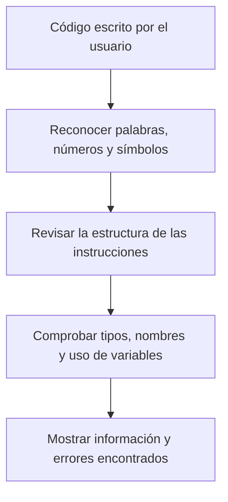
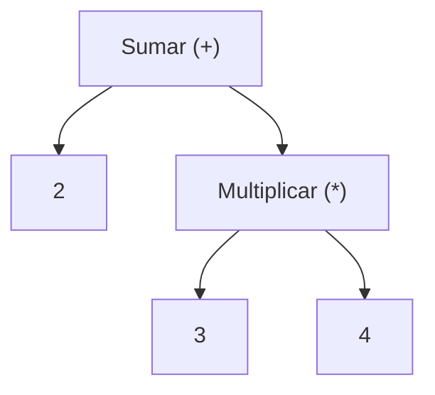
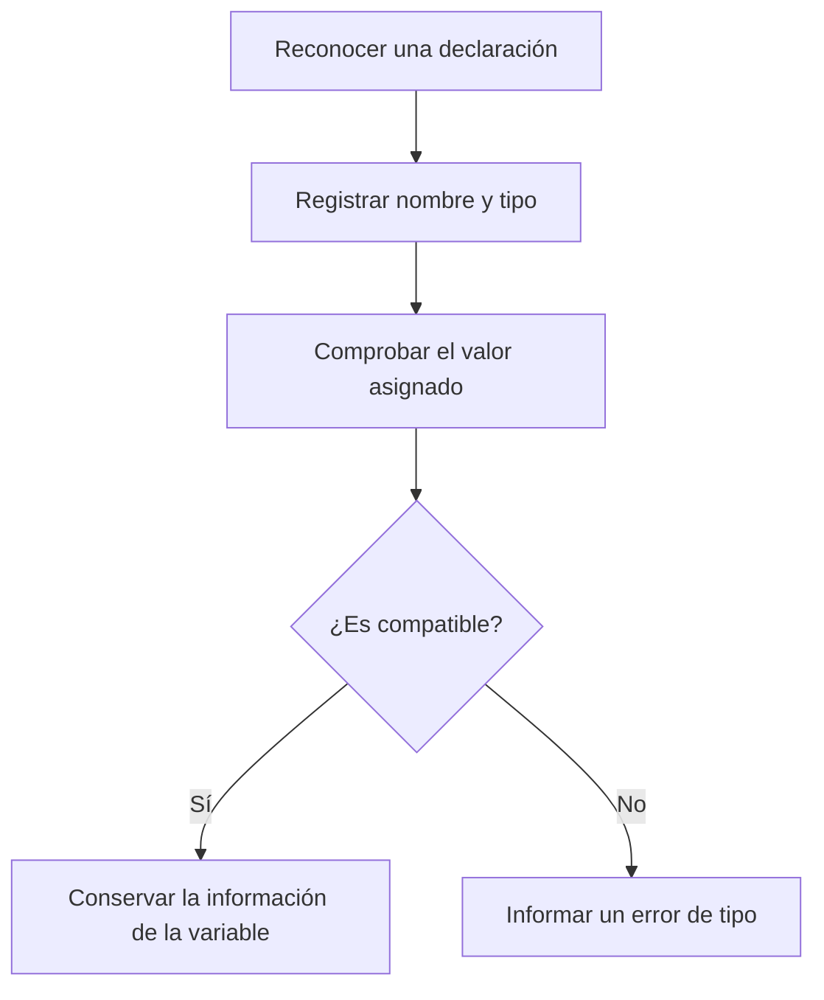

# Análisis semántico en nuestro lenguaje SharpC

## Índice

1. [Introducción](#introducción)
2. [Antecedentes](#antecedentes)
   - [Expresiones y árboles de expresión](#expresiones-y-árboles-de-expresión)
   - [Acciones semánticas](#acciones-semánticas)
   - [Comprobación de tipos](#comprobación-de-tipos)
   - [Pila semántica](#pila-semántica)
   - [Esquemas de traducción](#esquemas-de-traducción)
   - [Tabla de símbolos, ámbitos y direcciones](#tabla-de-símbolos-ámbitos-y-direcciones)
   - [Manejo de errores semánticos](#manejo-de-errores-semánticos)
3. [Aplicaciones](#aplicaciones)
4. [Código](#código)
5. [Resultados](#resultados)
6. [Conclusiones](#conclusiones)
7. [Bibliografía](#bibliografía)
8. [Glosario](#glosario)

## Introducción

Escribir un programa implica más que colocar palabras y símbolos en el orden correcto. También necesitamos que las instrucciones tengan sentido: que una variable exista antes de usarla, que reciba un valor antes de leerla y que los datos sean compatibles con las operaciones que queremos realizar.

Nuestro proyecto es un analizador de **SharpC**, un lenguaje educativo. Revisa el código y presenta información sobre sus variables, funciones y errores. Su objetivo es mostrar cómo se estudia un programa antes de ejecutarlo.

Pensemos en esta instrucción:

```text
ENT vEdad = "hola";
```

Su forma es correcta: tiene un tipo, un nombre, una asignación y un punto y coma. Sin embargo, intenta guardar texto en una variable entera. **Está bien escrita en su estructura, pero tiene un error de significado.** A ese tipo de revisión se le llama *análisis semántico*.

En esta presentación explicamos los conceptos con ejemplos de nuestro lenguaje. El analizador revisa los programas; todavía no los ejecuta ni calcula sus resultados numéricos.

Los ejemplos breves son fragmentos independientes que se colocan dentro de `INI { ... }`. En la sección **Código** aparece un programa completo explicado paso a paso.

## Antecedentes

Los compiladores traducen programas a otra representación. Para hacerlo, necesitan reconocer sus elementos, entender su estructura y comprobar sus reglas. Nuestro proyecto trabaja con esas etapas de análisis.

| Etapa | Pregunta que responde | Ejemplo |
| --- | --- | --- |
| Análisis léxico | ¿Qué elementos aparecen en el texto? | Reconoce `ENT`, `vEdad`, `=`, `18` y `;`. |
| Análisis sintáctico | ¿Están organizados de una forma permitida? | Comprueba que la declaración tenga la estructura adecuada. |
| Análisis semántico | ¿Se utilizan de manera coherente? | Comprueba que el valor asignado sea compatible con `ENT`. |



El diagrama representa el recorrido de un programa que supera las primeras revisiones. Si hay errores léxicos o sintácticos, primero deben corregirse para pasar a la revisión semántica.

### Expresiones y árboles de expresión

**¿Qué es una expresión?** Es una combinación de valores, variables y operadores. Por ejemplo, `2 + 3 * 4` es una expresión aritmética.

Un **árbol de expresión** muestra cómo se agrupan sus partes. Los operadores se representan como nodos y los valores como hojas. Sirve para entender qué operaciones dependen de otras.

En nuestro lenguaje podemos escribir:

```text
ENT vTotal = 2 + 3 * 4;
```

La multiplicación tiene prioridad sobre la suma. Por eso la expresión se agrupa como `2 + (3 * 4)`:



Si escribimos `(2 + 3) * 4`, los paréntesis cambian la agrupación: primero queda la suma dentro del grupo y después la multiplicación.

**En nuestro proyecto:** se respeta esta prioridad al revisar las expresiones. El árbol es una ilustración para explicarla; el reconocedor sintáctico no construye árboles. La fase posterior de código intermedio sí estructura las expresiones aritméticas soportadas para producir cuádruplos, sin mostrar el árbol en pantalla.

### Acciones semánticas

**¿Qué son?** Son las tareas que se realizan para comprobar o registrar el significado de una instrucción.

Por ejemplo, al encontrar:

```text
ENT vCantidad = 5;
```

el analizador necesita:

1. Reconocer que se está declarando una variable llamada `vCantidad`.
2. Registrar que su tipo es entero.
3. Comprobar que el nombre no esté repetido donde se declara.
4. Comprobar que `5` sea compatible con el tipo entero.

**¿Para qué sirven?** Conectan lo que está escrito con las reglas del lenguaje. Reconocer una declaración no basta: también hay que comprobar que pueda utilizarse correctamente.

### Comprobación de tipos

**¿Qué es un tipo de dato?** Es una categoría que indica qué clase de información puede representar un dato y qué operaciones se permiten con él.

Los tipos de nuestro lenguaje son:

| Tipo | Significado | Ejemplo de uso |
| --- | --- | --- |
| `ENT` | Número entero. | `ENT vCantidad = 5;` |
| `DEC` | Número que permite parte decimal. | `DEC vPrecio = 12.5;` |
| `TXT` | Cadena de texto. | `TXT vNombre = "Ana";` |
| `CAR` | Un carácter. | `CAR vGrupo = 'A';` |
| `BOOL` | Valor lógico: verdadero o falso. | `BOOL vActivo = VDD;` |
| `VAC` | Ausencia de valor de retorno en una función. | Se utiliza después de `FUNC`, no para declarar variables. |

`VDD` significa verdadero y `FALS`, falso.

La **comprobación de tipos** determina si los datos pueden combinarse o asignarse de la manera indicada. Los siguientes fragmentos se colocarían dentro de `INI { ... }`:

```text
DEC vPrecio = 10;
ENT vCantidad = 10.5;
```

La primera declaración es válida: un entero puede utilizarse donde se espera un decimal. Esta conversión permitida se llama **promoción de tipos**. La segunda se rechaza porque nuestro lenguaje no permite convertir automáticamente un decimal en entero.

También se revisan los operadores. `"hola" * 2` es incompatible, mientras que `"Total: " + 2` se admite como concatenación de texto.

### Pila semántica

**¿Qué es una pila?** Es una estructura parecida a una pila de platos: el último que se coloca es el primero que se retira.

La **pila semántica** conserva información temporal mientras se analiza una expresión. En nuestro proyecto guarda los tipos de los datos y de los resultados parciales. Otra pila ayuda a recordar los operadores pendientes.

Consideremos:

```text
DEC vResultado = 2 + 3 * 4.5;
```

La revisión puede explicarse así:

| Paso | Comprobación | Tipo obtenido |
| --- | --- | --- |
| 1 | Identificar `2`, `3` y `4.5`. | `ENT`, `ENT` y `DEC`. |
| 2 | Combinar los tipos de `3 * 4.5`. | `ENT * DEC` produce `DEC`. |
| 3 | Combinar `2` con el resultado anterior. | `ENT + DEC` produce `DEC`. |
| 4 | Comparar el resultado con el tipo de `vResultado`. | La asignación es compatible. |

**Idea principal:** para saber si la asignación es válida basta con conocer el tipo del resultado. El analizador no necesita calcular cuánto vale la operación.

### Esquemas de traducción

**¿Qué son?** Son una forma de asociar reglas de la gramática con acciones que producen información. Esa información puede ser un tipo, una entrada en una tabla, una traducción o instrucciones para una etapa posterior.

Una regla describe, por ejemplo, la forma de una declaración:

> Tipo + nombre + asignación opcional + punto y coma.

Las acciones asociadas explican qué hacer con esa declaración. Para `ENT vCantidad = 5;`, se registra el nombre, se identifica su tipo y se comprueba la asignación.



**En nuestro proyecto:** esta idea ayuda a explicar la relación entre gramática y semántica. Las comprobaciones se realizan después de aceptar la estructura del programa. Todavía no se genera código de máquina ni una traducción ejecutable.

### Tabla de símbolos, ámbitos y direcciones

**¿Qué es la tabla de símbolos?** Es un registro de los nombres declarados en el programa. Puede compararse con una lista de alumnos: el nombre identifica una entrada y las demás columnas guardan información sobre ella.

Para una variable, nos interesa conocer su nombre, tipo, lugar de declaración y ubicación simbólica. Por ejemplo:

```text
INI {
    ENT vCantidad = 2;
    DEC vPrecio = 3.5;
}
```

| Nombre | Tipo | Ámbito |
| --- | --- | --- |
| `vCantidad` | `ENT` | Principal (`INI`). |
| `vPrecio` | `DEC` | Principal (`INI`). |

**¿Qué es el ámbito?** Es la parte del programa donde se puede usar un nombre. Una variable de un bloque interior no queda disponible automáticamente fuera de él.

```text
INI {
    SI (VDD) {
        ENT vTemporal = 5;
        IMP(vTemporal);
    }
    IMP(vTemporal);
}
```

El primer `IMP(vTemporal);` usa una variable visible en ese bloque. El segundo produce un error porque está fuera de su ámbito. `IMP` representa una instrucción de impresión; aquí se revisa su uso, no se ejecuta la impresión.

En nuestro lenguaje se aplican estas reglas:

- Una variable debe declararse antes de utilizarse, incluso si declaración y uso están en la misma línea.
- No se puede declarar dos veces el mismo nombre en un ámbito.
- Un bloque interior no puede repetir un nombre declarado en un ámbito que lo contiene. A esa repetición se le llama **sombreado** y el proyecto la rechaza.
- Dos bloques separados que comparten un mismo contenedor pueden tener variables con el mismo nombre, siempre que no repitan el de un antecesor. Son declaraciones independientes.
- Los parámetros de una función pertenecen al ámbito de esa función.

**¿Qué son las direcciones?** Indican dónde se localizaría cada dato. Nuestro proyecto utiliza un modelo sencillo de **memoria simbólica**: una región para `INI` y otra por función.

Un **desplazamiento** indica a cuántos bytes del inicio de una región comienza una variable. En el ejemplo de `vCantidad` y `vPrecio`:

| Variable | Región | Tamaño | Desplazamiento |
| --- | --- | ---: | ---: |
| `vCantidad` | `INI` | 4 bytes | 0 |
| `vPrecio` | `INI` | 8 bytes | 4 |

La primera variable ocupa 4 bytes; por eso la siguiente comienza en 4. La región necesita 12 bytes simbólicos en total. No son direcciones reales de la computadora, sino una representación para estudiar la organización de los datos.

### Manejo de errores semánticos

**¿Qué son?** Son errores en el uso de las construcciones del lenguaje, aunque la estructura de la instrucción sea aceptada.

El documento del tema 1.7 los agrupa en inicialización, tipos de datos, lógica, alcance y recursos. En nuestro proyecto se observan de esta forma:

| Categoría | Ejemplo | ¿Qué se revisa? |
| --- | --- | --- |
| Inicialización | `ENT vEdad; IMP(vEdad);` | La variable existe, pero se lee antes de recibir un valor. |
| Tipos de datos | `ENT vEdad = "hola";` | El texto no es compatible con el tipo entero. |
| Lógica y condiciones | `SI (5) { }` | La condición debe producir un valor lógico, no un entero. |
| Alcance | Usar `vTemporal` fuera del bloque donde se declaró. | El nombre debe estar disponible en ese lugar. |
| Recursos | La suma de tamaños supera el límite de una región. | El contador de memoria simbólica debe permanecer dentro de su rango. |

También se comprueba que una llamada tenga la cantidad y los tipos de argumentos requeridos, y que cada `REGR` presente corresponda al retorno declarado de su función.

**Declarar no es lo mismo que inicializar.** `ENT vEdad;` crea una variable, pero todavía no le asigna un valor. `vEdad = 18;` le asigna uno. Además, si la asignación aparece únicamente dentro de un `SI` sin `SINO`, después del bloque podría seguir sin valor: no sabemos si esa rama se ejecutará.

**¿Cómo se tratan los errores?** Se informa el problema y su línea, y se continúa con las comprobaciones que sea posible realizar. Así el usuario puede corregir varios problemas en una misma revisión.

Que una comparación sea válida no demuestra que resuelva el problema deseado. Por ejemplo, el analizador puede aceptar `vEdad > 18`, pero no sabe si el autor quería escribir `vEdad >= 18`. Esa intención debe comprobarse al diseñar y probar el programa.

## Aplicaciones

- **Aprender cómo se analiza un lenguaje:** observar la diferencia entre reconocer palabras, revisar estructuras y comprobar su significado.
- **Detectar errores antes de ejecutar:** localizar variables inexistentes, datos incompatibles o lecturas sin inicialización.
- **Comprender el alcance de las variables:** explicar por qué un nombre se puede usar en un bloque y no en otro.
- **Estudiar la organización de los datos:** consultar tamaños y ubicaciones simbólicas en la tabla de símbolos.
- **Practicar con funciones:** comprobar qué datos recibe una función y qué tipo de dato debe devolver.

## Código

### Un programa que reúne los conceptos

El siguiente ejemplo está escrito en **nuestro lenguaje**. Usa variables, una expresión, una función y una llamada:

```text
INI {
    ENT vCantidad = 2;
    DEC vPrecio = 3.5;
    DEC vSubtotal = vCantidad * vPrecio;

    FUNC DEC fAgregarCargo(DEC vImporte) {
        REGR vImporte + 1;
    }

    DEC vTotal = fAgregarCargo(vSubtotal);
    IMP(vTotal);
}
```

**¿Cómo se lee?**

1. `INI` marca el bloque principal.
2. `vCantidad` guarda un entero y `vPrecio`, un decimal.
3. `vCantidad * vPrecio` produce una expresión de tipo decimal, compatible con `vSubtotal`.
4. `FUNC` declara `fAgregarCargo`, una función que recibe un decimal llamado `vImporte` y tiene retorno decimal.
5. `REGR` indica qué expresión devolvería la función. `vImporte + 1` es compatible con `DEC`.
6. La llamada entrega `vSubtotal` como argumento y su resultado es de tipo `DEC`, compatible con `vTotal`.
7. `IMP(vTotal);` solicita mostrar el valor cuando el lenguaje disponga de ejecución.

**¿Qué hace el analizador con él?** Revisa nombres, tipos, ámbitos, asignaciones y uso de la función. Registra las declaraciones y sus ubicaciones simbólicas. No realiza la multiplicación ni ejecuta la llamada.

### Un cambio que produce un error

Si sustituimos la llamada anterior por:

```text
DEC vTotal = fAgregarCargo("hola");
```

la forma de la llamada sigue siendo válida, pero el argumento es texto. Como la función espera un decimal, se informa un error de tipo. Este ejemplo muestra por qué la revisión sintáctica y la semántica se complementan.

## Resultados

### Información que presenta la aplicación

Al analizar un programa, se pueden consultar:

- **Tokens:** las categorías de los elementos reconocidos en el texto.
- **Tabla de símbolos:** nombre, tipo, texto de valor, ámbito, clase de símbolo, línea de declaración, región, tamaño y desplazamiento.
- **Tabla de funciones:** nombre, retorno, parámetros, líneas del cuerpo, región y tamaño del marco.
- **Errores:** el problema encontrado y el número de línea donde se detectó.

En el programa del apartado anterior, las variables principales pertenecen a `INI`, mientras que `vImporte` pertenece a `fAgregarCargo`. Sus regiones simbólicas son independientes.

| Declaración | Región | Tamaño | Desplazamiento |
| --- | --- | ---: | ---: |
| `vCantidad` | Principal | 4 bytes | 0 |
| `vPrecio` | Principal | 8 bytes | 4 |
| `vSubtotal` | Principal | 8 bytes | 12 |
| `vTotal` | Principal | 8 bytes | 20 |
| `vImporte` | Función `fAgregarCargo` | 8 bytes | 0 |

La región principal ocupa **28 bytes simbólicos** y el marco de la función, **8 bytes**. El desplazamiento 0 puede aparecer en ambas regiones porque son espacios independientes.

En la columna de valor se conserva el texto de la expresión, por ejemplo `vCantidad * vPrecio`. No debe interpretarse como el resultado calculado durante una ejecución.

### Pruebas realizadas y alcance

La batería registrada del proyecto contiene **317 pruebas correctas y 0 fallidas**. Incluye ejemplos válidos y casos de errores de sintaxis, tipos, ámbitos, inicialización, retorno garantizado, funciones, memoria simbólica, `LEER` y generación de cuádruplos, triplos y Código P, con presentación de tres direcciones y notaciones infija, prefija y postfija. También se verificó la compilación de la aplicación de escritorio.

Estas pruebas comprueban las clases de análisis; no automatizan la presentación visual ni la clasificación léxica conectada a la base de datos. Un resultado correcto en ellas respalda los casos comprobados, no garantiza detectar cualquier error imaginable.

La versión actual no ejecuta programas ni detecta fugas reales de memoria. Tampoco comprueba todavía el rango de los decimales ni los desbordamientos del resultado de operaciones. Sí comprueba retorno garantizado por caminos con un análisis conservador, sin evaluar constantes ni demostrar terminación de ciclos. Los alcances de cada comprobación están registrados en la [cobertura de los temas 1.6 y 1.7](pruebas-analizadores.md#cobertura-de-los-temas-16-y-17).

## Conclusiones

## Bibliografía

### Materiales de la asignatura disponibles en el proyecto

1. *Pila semántica en un analizador sintáctico*. (s. f.). Material del tema 1.4. [1.4_PILA_SEMANTICA (1).pdf](1.4_PILA_SEMANTICA%20%281%29.pdf).
2. *Esquema de traducción*. (s. f.). Material del tema 1.5. [1.5 Esquema de Traduccion.pdf](1.5%20Esquema%20de%20Traduccion.pdf).
3. *Generación de la tabla de símbolos y de direcciones; manejo de errores semánticos*. (s. f.). Material de los temas 1.6 y 1.7. [LyA2_1.6&1.7_Documento.pdf](LyA2_1.6%261.7_Documento.pdf).

### Documentación de apoyo

4. [Cobertura de errores de los temas 1.6 y 1.7](pruebas-analizadores.md#cobertura-de-los-temas-16-y-17). Documentación del proyecto.
5. [Pruebas de diagnósticos sintácticos y semánticos](pruebas-analizadores.md). Documentación del proyecto.
6. [Presentación técnica del analizador](presentacion-analizador-sharpc-tecnica.md). Consulta de clases, métodos y diagramas detallados.
7. [Guía breve de escritura](reglas-lexicas.md) y [ejemplos para probar](ejemplos-prueba.md). Material para quienes usarán el analizador.

## Glosario

| Palabra | Explicación sencilla |
| --- | --- |
| **Analizador** | Programa que revisa otro programa y obtiene información sobre él. |
| **Análisis léxico** | Reconocimiento de las palabras, números y símbolos que aparecen en el código. |
| **Lexema** | Texto concreto reconocido, como `vEdad` o `18`. |
| **Token** | Categoría de un elemento reconocido, como identificador, número u operador. |
| **Análisis sintáctico** | Revisión del orden y la estructura de las instrucciones. |
| **Gramática** | Conjunto de reglas que indica cómo se pueden escribir las instrucciones de un lenguaje. |
| **Semántico** | Relativo al significado. En programación, se refiere a las reglas de uso de nombres, datos y operaciones. |
| **Expresión** | Combinación de valores, variables y operadores, como `vPrecio * 2`. |
| **Árbol de expresión** | Representación de cómo se agrupan los operadores y sus operandos. |
| **Precedencia** | Prioridad de un operador respecto a otros; por ejemplo, multiplicar antes de sumar. |
| **Acción semántica** | Tarea que comprueba o registra el significado de una construcción del lenguaje. |
| **Tipo de dato** | Categoría de la información, como entero, decimal o texto. |
| **Pila semántica** | Estructura temporal que guarda información mientras se revisan expresiones; en nuestro proyecto guarda tipos. |
| **Esquema de traducción** | Asociación entre reglas de la gramática y acciones que producen información o una traducción. |
| **Símbolo** | Elemento declarado del programa, como una variable, una función o un parámetro. |
| **Tabla de símbolos** | Registro de los elementos declarados y sus características. |
| **Ámbito** | Parte del programa en la que se puede utilizar un nombre. |
| **Inicialización** | Primera asignación de un valor a una variable. |
| **Parámetro** | Dato que una función declara que necesita recibir, como `vImporte`. |
| **Argumento** | Expresión que se proporciona al llamar una función, como `vSubtotal`. |
| **Retorno** | Valor que una función devuelve; en nuestro lenguaje se indica mediante `REGR`. |
| **Región de memoria** | Espacio simbólico que agrupa las posiciones de las variables del principal o de una función. |
| **Marco de función** | Región que reúne el espacio de los parámetros y las variables locales de una función. |
| **Byte** | Unidad de información usada para expresar los tamaños del modelo de memoria. |
| **Desplazamiento** | Cantidad de bytes desde el inicio de una región hasta una variable. |
| **Análisis estático** | Revisión del código sin ejecutar sus instrucciones. |
